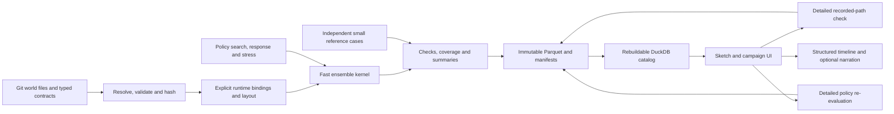

# Timeline Lab model and data architecture

**Design recommendation · 25 October 2026 · Revision 0.5**

Build a native strategic simulator supporting fast sketches, multiobjective policy search and inspectable histories. Begin with one bounded financing/commitment question, the indispensable actors and effects it requires, and independent reference calculations. The [product vision](product-vision.md), [requirements](requirements.md) and [backlog](backlog.json) define the scope and release gates.

The architecture keeps Git-versioned world files, Parquet/DuckDB results, Python execution and later detailed-ledger assessment. It adds early correctness/coverage gates, explicit fidelity projections, separate path checking and policy re-evaluation, multiobjective behavior archives and separate own-interest response versus hostile stress analysis.

## 1. The model foundation

A world state identifies entities, population, productive capacity, cash, debt, public/private claims, usable forces, supply, relations, institutions and legal rights at a date. Actions and events change it under versioned rules. Separate ownership and jurisdiction from practical control and access.

The first slice is a proposed Japan financing/commitment problem: terms and timing of an offer, acceptance/refusal/counteroffer, actual funding/draws, material monthly liquidity and supported readiness effects. Agree its actor roster, information and external conditions in M0. A bounded result cannot establish global diplomatic optimality or outcomes in omitted theatres.

Use one family of mechanism definitions with declared implementations and fidelity projections:

`simulate_fast(bundle, layout, policies, actor_models, world_design, draw_addresses, environment) → outcomes, traces, checks, manifest`

`check_recorded_path(bundle, recorded_actions_events, ledger_version) → postings, schedules, feasibility_discrepancies, manifest`

`reevaluate_policy(bundle, policy, world_design, detailed_state_rules) → new_trajectory, postings, checks, lineage`

Forensic checking and policy re-evaluation have different contracts. The first tests a recorded history; the second may produce a different one when detailed timing or resources change feasible choices.

| Rule | Example | Contract |
|---|---|---|
| Accounting identity | Closing cash equals opening cash plus classified receipts/payments and valuation effects | Reconcile under a declared numeric policy at each supported step |
| Legal/contract rule | Appropriation, loan terms, treaty consent, ownership and expiry | Explicit parties, authority, dates and exceptions |
| Behavior/economic rule | Investment response, refusal, mobilisation, trade or disruption effects | Equation/procedure, lag, coefficient or preference, evidence and uncertainty |

Baseline fit does not establish counterfactual behavior. An exogenous GDP series cannot silently become evidence that a financing action caused growth.

## 2. Components and flow

| Component | Responsibility |
|---|---|
| Typed declarations | Shared structural contracts, units, capability metadata and schema versions |
| Git world catalog | Author-written entities, assumptions, overlays, objectives and named versions |
| Resolver | Pinned ancestry, effective dates, references, conflicts and complete content-addressed bundles |
| Runtime binding/compiler | Explicit indexing, initialization, unit conversion and state-update ownership |
| Fast engine | Supported world transitions and actor decisions without UI, storage or network calls |
| Independent reference cases | Separately derived expectations for changed financial inputs and feasibility |
| Detailed ledger | Full instruments and postings; forensic and policy re-evaluation modes |
| Search | Global/per-cell trade-offs, budgeted sampling, own-interest responses, separate stress and fresh assessment |
| Artifact coordinator | Durable immutable files/manifests, recovery and query-index registration |
| Local application | Narrow sketch controls first; general editing, campaigns and optional narration later |

The finance skill proposes inspectable quantities and derivations as catalog changes. Model modules compute them. Language models cannot invent runtime coefficients or alter calculated events.

## 3. Typed authoring and runtime state

### Structural declarations

Use typed Python models for supported world, mechanism, experiment and provenance structures. Keep these concerns separate while allowing explicit references: a world object can reference provenance without embedding a run's state or executable logic.

| Layer | Examples |
|---|---|
| World | Entity, territory, population, capacity, instrument, right, force, route and relation |
| Mechanism | Action, event, actor model, observation rule, transition, constraint, metric and module |
| Experiment | Sketch, objective set, descriptor, policy, campaign, rollout, assessment and history type |
| Provenance | Source, content hash, engine/environment, calibration/reference case and narration claim |

R0 needs minimal validated schemas and explicit bindings for the bounded question. Pydantic can generate JSON Schema from typed models. R1 can add generated structural schemas, form scaffolds, result schemas and layout metadata where useful. [Pydantic JSON Schema](https://docs.pydantic.dev/latest/concepts/json_schema/).

Generation does not supply mathematical behavior, legal approval, good interaction design, initialization or migration. A descriptive field can be generated structurally; a state-changing field needs reviewed units, binding, transition, migration and tests before execution. CI checks generated drift and missing bindings. A universal generator is not an M0 prerequisite.

### Runtime layout

Compile supported inputs into dense blocks or bounded structures with stable identity maps. Illustrative blocks are:

| Block | Possible shape | Contents |
|---|---|---|
| Economy | worlds × actors × quantities | Population, capacity, output, prices, revenues and spending |
| Claims | worlds × debtor × creditor class × maturity/currency bucket | Public/private principal, service and settlement exposure |
| Sustainment | worlds × actor × theatre × resource | Usable forces, stocks, readiness and supply |
| Relations | worlds × actor × actor × relation field | Consent, access, obligations and pending offers |
| Routes | worlds × routes × quantities | Capacity, use, disruption and recovery |
| Action queues | worlds × bounded slots × fields | Stages, dates, costs, authority and completion |

Pin dimensions, mappings and activation masks. A newly activated actor, instrument or queue item needs declared capacity. Overflow is an explicit unsupported/error state, never silent truncation. Stable logical IDs govern provenance and randomness; array positions are implementation details.

The detailed ledger uses full instruments with a documented projection back to fast aggregates. Record what information an aggregate loses, how maturities/FX/exposures are approximated and which situations invalidate its feasibility claim.

## 4. Storage and publication

For one local author, use schema-validated YAML or TOML in Git for author-written catalog and overlays; immutable Parquet for numerical artifacts; retained manifests and DuckDB for local queries.

| Data | Storage |
|---|---|
| World, mechanism configuration, assumptions, objectives and saved sketches | Validated text, pinned Git parent and commit plus resolved-content hash |
| Unsaved lever edits | Temporary content-addressed draft state; explicitly save a named version |
| Source attachments | Original bytes in Git/LFS or versioned private artifact storage, with hashes |
| Compact results, selected traces and history features | Batched content-addressed Parquet |
| Run/campaign identity, assets, statuses and environment | Retained immutable manifests |
| Query index | Local DuckDB catalog rebuildable from retained manifests and artifacts |

Workers write owned temporary/result artifacts; one coordinator registers completed artifacts. DuckDB supports a single in-process writer process with concurrent threads; the proposed topology does not require multiple worker processes to update its native file. [DuckDB concurrency](https://duckdb.org/docs/current/connect/concurrency).

Publication spans separate durability domains. An atomic rename is not a transaction covering files, Git and DuckDB. Persist files and manifest, validate completeness/checksums, then commit the catalog registration. On interruption, reconcile orphan files, missing assets and incomplete manifests. Never publish partial output as a complete run. Guard saved Git refs against the expected parent and reject stale-tab overwrites.

Rebuild the query index from retained manifests. Keep resolved bundles and referenced Git/assets reachable so later edits or cleanup cannot make a pinned result unreplayable.

PostgreSQL remains a candidate for a later hosted/multi-user mode. SQLite is also viable for small transactional metadata. RDF/document stores are unnecessary for the stated numeric workflow; this recommendation does not depend on categorical claims that those systems cannot validate data.

## 5. Fast execution and reproducibility

### Transitions and timing

Each supported step applies events, builds dated actor observations, collects decisions, resolves authority/consent/resources, advances the supported mechanisms, checks identities/constraints and records outcomes. Simultaneous choices use a frozen observation state; sequential negotiations have explicit rounds.

Annual strategic reporting does not authorize annual-only cash accounting. Resolve months or event dates when a draw, rollover, route interruption or commitment can change feasibility. A coarser conditional experiment must state the omitted risk. Feedback loops need a declared lag or solver with convergence/failure behavior.

Use NumPy batching where effective and Numba-compiled kernels for irregular branching or queues. Avoid interpreted Python dispatch per world in the hot path; compiled loops are valid and may outperform forced masking. Profile real data and memory rather than treating vectorization as a correctness rule. [Numba performance guidance](https://numba.readthedocs.io/en/stable/user/performance-tips.html). Consider Rust only if the measured supported workload requires it.

### Random draws and environment

Philox is a suitable counter-based building block, not a complete reproducibility design. Register stable draw addresses such as:

`(world_design_id, world_id, time, stream, actor_or_event_id, draw_ordinal)`

Use separate namespaces for exogenous conditions, endogenous/actor/policy randomness and optimizer proposals. Matched sketches explicitly reuse the exogenous world design; changing a display/campaign label must not break that coupling. New branches cannot shift unrelated draws by consuming a variable-length shared stream.

Pin PRNG/distribution transformations, dependency builds, numeric settings and the environment. NumPy's compatibility guarantees depend on call sequence, arguments and build/environment; changing requested batch shape is not automatically stream-compatible. Test the wrapper's actual single/batch/partition behavior. [Philox](https://numpy.org/doc/stable/reference/random/bit_generators/philox.html), [NumPy compatibility](https://numpy.org/doc/stable/reference/random/compatibility.html).

Within a pinned supported environment, logical draws/events agree and numeric outputs meet declared tolerances. Cross-platform support has an explicit numeric and decision-boundary contract, including ties/thresholds. Match policy randomness when requiring identical actions from identical observations. Pin golden draw/reference cases and record unsupported environment changes.

### Progressive results

Evaluate growing world chunks and stream current-identity summaries. A new edit supersedes old work; retained old results remain inspectable under their own identity and cannot update the new view. Show count, partial/complete/error state, coverage, calibration and sample uncertainty. New external conditions and endogenous consequences remain distinguishable.

## 6. Reference accounts and detailed fidelity

### Early reference evidence

M0/R0 includes small independent reference calculations for the bounded claim. Compare a baseline and accepted/refused/counteroffered facilities; change interest, maturity and draw dates; test failed rollover, public/private shares, foreign currency and an interim cash shortage. Check both accounting values and whether later actions remain feasible.

Expectations are independently derived or enumerable, not copied from the fast implementation. These checks are smaller than the full R2 ledger and do not claim its coverage. Source calibration may be extracted read-only; no production calculation invokes Excel or spreadsheet formulas.

### Fidelity contract

Use shared mechanism definitions with explicit fast aggregation and detailed instrument implementations. Avoid two independently invented growth, legal or actor models.

| Comparison | What it establishes |
|---|---|
| Numeric identity tolerance | Arithmetic/rounding consistency for the supported accounts |
| Baseline calibration band | Fit to a named source aggregate series under baseline conditions |
| Changed-input reference check | Correctness of a specific response and feasibility case |
| Fidelity envelope/projection check | Assessed differences between fast and detailed outputs over declared cases |
| Decision/feasibility discrepancy | A materially different available action, acceptance, funding or terminal state |

A baseline band is not a universal error bound. Discrete feasibility changes require review even when a monetary difference is inside that band. Register discrepancy policy by metric and decision, with evidence scope and unresolved coverage.

### Two detailed modes

**Forensic mode** holds recorded actions/events fixed to check accounts and identify the first impossible or inconsistent commitment. Report the mismatch and downstream conditionality. Do not force an invalid loan, invent bridging finance or call the rest of the history feasible.

**Policy re-evaluation** runs the same conditional Pacifica policy and matched exogenous-world design under detailed resources and observations. Counterparties and later actions may change. Save a new linked history with mode, policy/model/world versions and differences; preserve the original fast trace.

Report gaps, sample sufficiency and assessment status. Promote or rerank only a sufficiently and consistently assessed set; do not combine detailed outcomes for a lucky selected path with fast distributions for everyone else. Separate response/fidelity sensitivity from demonstrated model defects.

Decimal postings need explicit precision, conversion and rounding rules. Decimal arithmetic does not remove uncertainty or make an aggregated behavioral model exact. [Python Decimal](https://docs.python.org/3/library/decimal.html).

### Full financial regression

R2 reconstructs native Treasury, instrument, GDP/price and programme/right modules and compares the frozen six bundles: 87 annual periods, 73 metrics, 17 labelled runs plus finer schedules. Read the exact files and preserve aliases/conditions. Run clean supported Windows/Linux tests without Office, including changed inputs absent from the bundles.

Fixture replay can prescribe authored events for arithmetic equivalence. Discovery cannot. Intentional corrections require a new version and reconciliation note; reproducing a spreadsheet error is not validation. Full parity cannot establish political response probabilities or physical feasibility.

## 7. Search and assessment

| Component | Method and boundary | Output |
|---|---|---|
| Global trade-offs | Benchmark NSGA-II/III or another suitable mixed-policy multiobjective search | Best-found nondominated policies |
| Behavior archive | Bounded nondominated sets per cell; explicit deterministic diversity-pruning | Different policy types with within-cell trade-offs |
| Actor response | Best/near-best response to the actor's own utility or declared preference procedure | Cooperation, bargaining or competition under the actor model |
| Hostile stress | Minimize a named Pacifica outcome subject to actor plausibility, information and own-outcome bounds | Separately labelled worst-found stress and sensitivity |
| Sampling | Initial screening, adaptive additional samples and precision/stopping rules | Uncertainty-aware ranks and tails |
| Final assessment | Fresh worlds and alternative models after policies/responses are frozen | Assessed distributions, failure conditions and unresolved claims |

An ordinary MAP-Elites archive selects by scalar quality. Pacifica's archive must instead preserve multiobjective alternatives. Define descriptor aggregation over a common world design, never/undefined bins, uncertainty and cell-instability behavior; define capacity and pruning without a hidden mandatory weighted score. Exhaustive small benchmarks test nondominance and pruning separately. [pyribs GridArchive](https://docs.pyribs.org/en/latest/api/ribs.archives.GridArchive.html).

Actor best response is not synonymous with damaging Pacifica. Hostile stress explicitly declares which Pacifica quantity it targets and how far an actor may deviate from its own acceptable or near-best outcome. One revision round is a bounded sensitivity procedure, not a solved game. Lost advantage alone is not an exploit; an exploit finding needs a documented defect/counterexample. PSRO supplies a methodological reference for response-policy search, not an automatic equilibrium guarantee. [PSRO](https://arxiv.org/html/1711.00832v2).

About 100 worlds per policy is an initial screen. Use registered uncertainty/precision criteria to allocate further samples to close ranks or sparse tails, count them against budget, and report unresolved rankings. Keep structural uncertainty separate from sampling error. Final assessment worlds are never reused as fresh evidence after tuning.

The base throughput target is 100,000 evaluations in five minutes on the declared 8-worker/16-GB workload, including realistic response/queue/check/log/summary work. Extra response/stress searches, sampling, final assessment, clustering and narration are separately budgeted, then included in total campaign cost.

Checkpoint policies, search state, archive/pruning rules, pending evaluations, deterministic update order, draw addresses and budgets. Resume under the pinned contract; a wall-time stop can change the explored policy set and must not promise identical optimization results across different hardware.

## 8. Histories and narration

R0's structured timeline and deterministic template summary need no network or LLM. Events record decisions, observations, counterpart responses, resource effects, chance and provenance.

R1 clusters assessed event/trajectory features into history types and records feature scaling, method, parameters, shares, distinguishing associations and an actual representative. Preserve rare/outlier and terminal paths; computational errors are not invented trajectories. PRIM or similar scenario discovery may explain associations, with controlled reruns needed for model-based causal claims.

Optional narration consumes typed claims and event references after computation. Insert numbers from saved results. Motives and causal relationships need explicit supporting records as well as actor/date/event identity. Number/ID matching cannot prove semantic truth; templates and typed claims are authoritative, while unsupported or ambiguous free prose is rejected, separated as author speculation or reviewed.

Store claim references, prompt/model/provider and check versions. Narration is draft/non-canon and cannot mutate results. The offline structured product remains complete.

## 9. Identity, branching and recovery

A saved overlay pins a parent and dated changes; the resolver materializes complete immutable inputs. Record both fictional effective time and save time. Distinguish a world event from saving a sketch.

Cache identity includes resolved content, policy/actor/mechanism/fidelity versions, schemas and bindings, uncertainty/draw design and environment. Display labels and timestamps cannot establish calculation equivalence. Keep source and assumption IDs from the first plotted number; deep formula/posting navigation can follow in R2.

Separate authority, evidence, execution, accounting, funding, coverage and fidelity statuses. Record terminal losses and errors without silently dropping either. Numeric ranking under unresolved errors requires an explicit bound or remains unavailable.

## 10. Build order

| Stage | Concrete exit |
|---|---|
| M0 correctness and speed | Agree one bounded question, actors, observations, metrics, evidence and temporal resolution. Establish minimal types/bindings, baseline plus independent changed-input cases and a realistic throughput spike. Confirm or revise targets before implementation commitments. |
| M1 bounded sketchpad R0 | Validated native core, independent refusal/counteroffers, material cash timing, ownership/coverage/basic tracing, versioned saves, recoverable artifacts, progressive fans and offline structured replay |
| M2 discovery R1 | Global/per-cell archives, adaptive samples, own-interest responses and separate stress, fresh assessment, history types, general editing, useful structural generation and optional bounded narration |
| M3 detailed fidelity R2 | Full instruments, forensic checking and separate policy re-evaluation, six-fixture parity, finance-skill derivations and full impact/provenance inspection |
| M4 expansion R3 | Additional supported questions/regions/actors, semantic rebases and separately designed hosted/multi-user mode |

The stack remains provisional: native Python, NumPy/Numba as profiled, Git text, Parquet/DuckDB, FastAPI and React/TypeScript. Fixed-shape layouts and metadata generation serve the supported model; they are not a commitment to an all-purpose world-code generator.

The revision 0.5 [requirements](requirements.md) and [backlog](backlog.json) define 67 stable requirements, first-release dependencies and explicit later phase gates. The [fixture manifest](fixture-manifest.json) preserves financial reference identities; the [objective sheet](objectives-and-constraints.md) and [action/actor catalog](action-and-actor-catalog.md) remain proposed model definitions.
