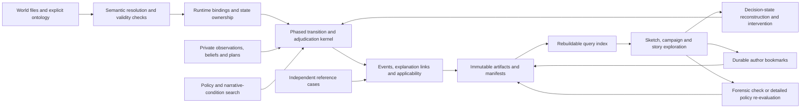

# Timeline Lab model and data architecture

**Design recommendation · 25 October 2026 · Revision 0.6**

Build a native simulator supporting strategic sketches, plot exploration, multiobjective policy search and inspectable histories. Begin with one bounded financing/commitment dilemma, indispensable actors, selected character beliefs/intentions and independent reference calculations. Prove the author workflow before expanding search and supporting tooling. The [product vision](product-vision.md), [requirements](requirements.md) and [backlog](backlog.json) define the scope and release gates.

The architecture keeps Git-versioned world files, Parquet/DuckDB results, Python execution, explicit fidelity projections and later detailed-ledger assessment. Revision 0.6 adds a semantic resolver, actor information/intention state, an explicit adjudication protocol, complete decision branches, narrative query/retention services and runtime applicability propagation.

## 1. The model foundation

A world state identifies entities, population, productive capacity, cash, debt, public/private claims, usable forces, supply, relations, institutions and legal rights at a date. Actions and events change it under versioned rules. Separate ownership and jurisdiction from practical control and access.

The first slice is a proposed Japan financing/commitment dilemma: terms and timing, acceptance/refusal/counteroffer, actual funding/draws, monthly liquidity and supported readiness effects, plus one selected institutional conflict and consequential belief/plan change. M0 selects its actor roster, narrative conditions, lawful/breach comparison, consequences and external conditions; these test ingredients are not canon. A bounded result cannot establish global diplomatic optimality or outcomes in omitted theatres.

Use one family of mechanism definitions with declared implementations and fidelity projections:

`simulate_fast(bundle, layout, policies, actor_models, world_design, draw_addresses, environment) → outcomes, traces, checks, manifest`

`check_recorded_path(bundle, recorded_actions_events, ledger_version) → postings, schedules, feasibility_discrepancies, manifest`

`reevaluate_policy(bundle, policy, world_design, detailed_state_rules) → new_trajectory, postings, checks, lineage`

Forensic checking and policy re-evaluation have different contracts. The first tests a recorded history; the second may produce a different one when detailed timing or resources change feasible choices.

| Rule | Example | Contract |
|---|---|---|
| Accounting identity | Closing cash equals opening cash plus classified receipts/payments and valuation effects | Reconcile under a declared numeric policy at each supported step |
| Legal/contract rule | Appropriation, loan terms, treaty consent, ownership and expiry | Explicit parties, authority, dates and exceptions; separate legal status from physically executable conduct and its consequences |
| Behavior/economic rule | Investment response, refusal, mobilisation, trade or disruption effects | Equation/procedure, lag, coefficient or preference, evidence and uncertainty |

Baseline fit does not establish counterfactual behavior. An exogenous GDP series cannot silently become evidence that a financing action caused growth.

## 2. Components and flow

| Component | Responsibility |
|---|---|
| Semantic contract and types | Ontology identities, qualified relations, time/status meanings, invariants and minimal typed schemas |
| Git world catalog | Author-written entities, assumptions, overlays, objectives and named versions |
| Resolver | Pinned ancestry, typed references, effective/information dates, semantic conflicts, active record subset and complete immutable bundles |
| Runtime binding/compiler | Explicit indexing, initialization, unit conversion and state-update ownership |
| Actor state and observation boundary | Private beliefs, plans and memories; eligibility, previews and messages use permitted information |
| Adjudication kernel | Registered phases, actual preconditions, independent consent, resource reservations, settlement and disclosed observations |
| Fast engine | Supported transitions without UI, storage or network calls; runtime applicability and status propagation |
| Independent reference cases | Separately derived expectations for changed financial inputs and feasibility |
| Detailed ledger | Full instruments and postings; forensic and policy re-evaluation modes |
| Search | Global/per-cell trade-offs, budgeted sampling, own-interest responses, separate stress and fresh assessment |
| Artifact coordinator | Durable immutable files/manifests, recovery and query-index registration |
| Branch service | Complete decision-state reconstruction; separate decision, premise and imposed-event modes |
| Story exploration | Narrative predicates, bounded route/minimum-change search and durable bookmarks outside Pareto pruning |
| Author evaluation | Predeclared writing tasks and recorded acceptance before broad tooling or scale |
| Local application | Narrow forms and deterministic summaries first; general editing and optional prose in R2 |

The finance skill proposes inspectable quantities and derivations as catalog changes. Model modules compute them. Language models cannot invent runtime coefficients or alter calculated events.

## 3. Typed authoring and runtime state

### Semantic ontology

The [ontology](ontology.md) defines the contract that structural declarations implement. Its record and invariant register is mirrored in `draft-model-catalog.json.ontology_contract`; neither file is an implemented runtime schema. R0 activates only the subset needed for its dilemma.

Separate people, offices, institutions and factions, with dated role tenure and explicit succession mappings. Distinguish underlying WorldFact, Assertion, delivered Observation and actor Belief. Goals, Plans and Commitments can explain action without making promises into legal Obligations. Agreements express qualified parties, authority, terms, dates, rights and termination. ActionAttempt, Adjudication and RealizedEvent retain separate identities.

Semantic validation checks reference domains/cardinality, ownership, temporal/branch scope, unknown/disputed values, action/profile compatibility and mechanism read/write ownership before compilation. Unresolved material truth requires a declared hypothesis branch or blocks the mechanism using it. Source disagreement never silently becomes a world fact.

Keep valid/effective time, information receipt and author recording time distinct. Preserve institutional liabilities through leadership changes unless an explicit rule transfers or extinguishes them. A graph database is not required: typed records and reference tables carry these semantics, and stable logical IDs map to runtime indices.

### Structural declarations

Use typed Python models for supported world, mechanism, experiment and provenance structures. Keep these concerns separate while allowing explicit references: a world object can reference provenance without embedding a run's state or executable logic.

| Layer | Examples |
|---|---|
| World | Entity, role tenure, territory, population, capacity, agreement, obligation, right, force, route and fact |
| Actor information/intention | Assertion, observation, belief, goal, plan and commitment |
| Mechanism | Action, event, actor model, observation rule, transition, constraint, metric and module |
| Experiment | Sketch, profile, intervention, checkpoint, narrative query, bookmark, objective set, policy, campaign and assessment |
| Provenance | Source, content hash, engine/environment, calibration/reference case and narration claim |

R0 needs minimal validated schemas and explicit bindings for the bounded question. Pydantic can generate JSON Schema from typed models. R2 can add generated structural schemas, form scaffolds, result schemas and layout metadata after the author workflow is proven. [Pydantic JSON Schema](https://docs.pydantic.dev/latest/concepts/json_schema/).

Generation does not supply mathematical behavior, legal approval, good interaction design, initialization or migration. A descriptive field can be generated structurally; a state-changing field needs reviewed units, binding, transition, migration and tests before execution. CI checks generated drift and missing bindings. A universal generator is not an M0/R0/R1 prerequisite.

### Runtime layout

Compile supported inputs into dense blocks or bounded structures with stable identity maps. Illustrative blocks are:

| Block | Possible shape | Contents |
|---|---|---|
| Economy | worlds × actors × quantities | Population, capacity, output, prices, revenues and spending |
| Claims | worlds × debtor × creditor class × maturity/currency bucket | Public/private principal, service and settlement exposure |
| Sustainment | worlds × actor × theatre × resource | Usable forces, stocks, readiness and supply |
| Relations | worlds × actor × actor × relation field | Consent, access, obligations and pending offers |
| Routes | worlds × routes × quantities | Capacity, use, disruption and recovery |
| Action queues | worlds × bounded slots × fields | Attempts, phases, dates, costs, authority and completion |
| Actor information/intention | worlds × actors × registered proposition/plan slots | Delivered observations, beliefs, active goals, plan status and memory |
| Reservations | worlds × bounded reservation slots | Owner, resource, amount, competing attempts, allocation and settlement status |

Pin dimensions, mappings and activation masks. A newly activated actor, instrument or queue item needs declared capacity. Overflow is an explicit unsupported/error state, never silent truncation. Stable logical IDs govern provenance and randomness; array positions are implementation details. Beliefs/queues can use bounded sparse structures when dense layout is wasteful. Keep global truth out of actor input views; runtime masks and diagnostics are part of that boundary.

The detailed ledger uses full instruments with a documented projection back to fast aggregates. Record what information an aggregate loses, how maturities/FX/exposures are approximated and which situations invalidate its feasibility claim.

## 4. Storage and publication

For one local author, use schema-validated YAML or TOML in Git for author-written catalog and overlays; immutable Parquet for numerical artifacts; retained manifests and DuckDB for local queries.

| Data | Storage |
|---|---|
| World, mechanisms, assumptions, objectives, narrative queries and saved sketches | Validated text, pinned Git parent and commit plus resolved-content hash |
| Unsaved lever edits | Temporary content-addressed draft state; explicitly save a named version |
| Source attachments | Original bytes in Git/LFS or versioned private artifact storage, with hashes |
| Compact results, selected traces and history features | Batched content-addressed Parquet |
| Decision checkpoints and actor state | Versioned immutable artifacts or a verified deterministic reconstruction recipe |
| Author bookmarks and review records | Durable versioned records retaining policy/history/query, assumptions, status and referenced assets |
| Run/campaign identity, assets, statuses and environment | Retained immutable manifests |
| Query index | Local DuckDB catalog rebuildable from retained manifests and artifacts |

Workers write owned temporary/result artifacts; one coordinator registers completed artifacts. DuckDB supports a single in-process writer process with concurrent threads; the proposed topology does not require multiple worker processes to update its native file. [DuckDB concurrency](https://duckdb.org/docs/current/connect/concurrency).

Publication spans separate durability domains. An atomic rename is not a transaction covering files, Git and DuckDB. Persist files and manifest, validate completeness/checksums, then commit the catalog registration. On interruption, reconcile orphan files, missing assets and incomplete manifests. Never publish partial output as a complete run. Guard saved Git refs against the expected parent and reject stale-tab overwrites.

Rebuild the query index from retained manifests. Keep resolved bundles and referenced Git/assets reachable so later edits or cleanup cannot make a pinned result unreplayable. Author bookmarks pin their referenced artifacts independently of optimizer archives; pruning or clustering cannot delete them.

PostgreSQL remains a candidate for a later hosted/multi-user mode. SQLite is also viable for small transactional metadata. RDF/document stores are unnecessary for the stated numeric workflow; this recommendation does not depend on categorical claims that those systems cannot validate data.

## 5. Fast execution and reproducibility

### Transitions and timing

Use the [ontology action protocol](ontology.md#action-and-adjudication-protocol): apply due events/deliver observations; update beliefs/plans; collect observation-safe attempts; resolve actual preconditions/authority/counterpart replies; reserve and allocate resources; settle implementation; then disclose permitted outcomes and record explanation links. Each phase has a registered order. Simultaneous attempts use frozen actor observations; negotiations have explicit rounds.

Eligibility masks, previews, rejection messages and fallbacks must not inspect hidden truth on the actor's behalf. Reasonable attempts can fail when actual conditions resolve. Internal adjudication records remain separate from actor-visible observations.

Register resource priority, deterministic ties or addressed random ties, reservation release/expiry and atomic versus partial agreement semantics. Competing modules cannot both spend the same cash/collateral/transport slot. Changing incidental actor/module order must not alter results.

A lawful profile rejects unauthorized execution. A selected breach-exploration profile enables only registered physically possible breaches with covered institutional, enforcement and obligation consequences. Physical/accounting invariants and locked authorial premises remain binding. Later cure preserves the earlier breach record.

Annual strategic reporting does not authorize annual-only cash accounting. Resolve months or event dates when a draw, rollover, route interruption or commitment can change feasibility. A coarser conditional experiment must state the omitted risk. Feedback loops need a declared lag or solver with convergence/failure behavior.

Use NumPy batching where effective and Numba-compiled kernels for irregular branching or queues. Avoid interpreted Python dispatch per world in the hot path; compiled loops are valid and may outperform forced masking. Profile real data and memory rather than treating vectorization as a correctness rule. [Numba performance guidance](https://numba.readthedocs.io/en/stable/user/performance-tips.html). Consider Rust only if the measured supported workload requires it.

### Random draws and environment

Philox is a suitable counter-based building block, not a complete reproducibility design. Register stable draw addresses such as:

`(world_design_id, world_id, time, stream, actor_or_event_id, draw_ordinal)`

Use separate namespaces for exogenous conditions, endogenous/actor/policy randomness and optimizer proposals. Matched sketches explicitly reuse the exogenous world design; changing a display/campaign label must not break that coupling. New branches cannot shift unrelated draws by consuming a variable-length shared stream.

Pin PRNG/distribution transformations, dependency builds, numeric settings and the environment. NumPy's compatibility guarantees depend on call sequence, arguments and build/environment; changing requested batch shape is not automatically stream-compatible. Test the wrapper's actual single/batch/partition behavior. [Philox](https://numpy.org/doc/stable/reference/random/bit_generators/philox.html), [NumPy compatibility](https://numpy.org/doc/stable/reference/random/compatibility.html).

Within a pinned supported environment, logical draws/events agree and numeric outputs meet declared tolerances. Cross-platform support has an explicit numeric and decision-boundary contract, including ties/thresholds. Match policy randomness when requiring identical actions from identical observations. Pin golden draw/reference cases and record unsupported environment changes.

### Applicability during execution

Each mechanism owns declared state updates and an applicability predicate over state, actions and relevant history. Evaluate it at initialization and around material transitions; record the first unsupported condition and propagate its status to dependent claims. Conflicting writers require an explicit resolver. Evidence, scale/institution/time limits, uncertainty and independent intervention/counterexample tests are part of the mechanism contract.

Default handling withholds affected calculations or stops the affected path without discarding its status. A registered provisional replacement can be explicitly selected as a new linked conditional continuation. It must define all required state and its limits; it cannot invent missing quantities. Conditional/error paths remain in total population accounting and cannot certify ordinary rankings. Structural variants retain separate summaries unless an explicit weighting contract supports pooling.

### Progressive results

Evaluate growing world chunks and stream current-identity summaries. A new edit supersedes old work; retained old results remain inspectable under their own identity and cannot update the new view. Show count, partial/complete/error state, coverage, calibration and sample uncertainty. New external conditions and endogenous consequences remain distinguishable.

## 6. Reference accounts and detailed fidelity

### Early reference evidence

M0/R0 includes small independent reference calculations for the bounded claim. Compare a baseline and accepted/refused/counteroffered facilities; change interest, maturity and draw dates; test failed rollover, public/private shares, foreign currency and an interim cash shortage. Check both accounting values and whether later actions remain feasible.

Expectations are independently derived or enumerable, not copied from the fast implementation. These checks are smaller than the full R2 ledger and do not claim its coverage. Source calibration may be extracted read-only; no production calculation invokes Excel or spreadsheet formulas.

### Fidelity contract

Use shared mechanism definitions with explicit fast aggregation and detailed instrument implementations. Avoid two independently invented growth, legal or actor models.

| Comparison | What it establishes |
|---|---|
| Numeric identity tolerance | Arithmetic/rounding consistency for the supported accounts |
| Baseline calibration band | Fit to a named source aggregate series under baseline conditions |
| Changed-input reference check | Correctness of a specific response and feasibility case |
| Fidelity envelope/projection check | Assessed differences between fast and detailed outputs over declared cases |
| Decision/feasibility discrepancy | A materially different available action, acceptance, funding or terminal state |

A baseline band is not a universal error bound. Discrete feasibility changes require review even when a monetary difference is inside that band. Register discrepancy policy by metric and decision, with evidence scope and unresolved coverage.

### Two detailed modes

**Forensic mode** holds recorded actions/events fixed to check accounts and identify the first impossible or inconsistent commitment. Report the mismatch and downstream conditionality. Do not force an invalid loan, invent bridging finance or call the rest of the history feasible.

**Policy re-evaluation** runs the same conditional Pacifica policy and matched exogenous-world design under detailed resources and observations. Counterparties and later actions may change. Save a new linked history with mode, policy/model/world versions and differences; preserve the original fast trace.

Report gaps, sample sufficiency and assessment status. Promote or rerank only a sufficiently and consistently assessed set; do not combine detailed outcomes for a lucky selected path with fast distributions for everyone else. Separate response/fidelity sensitivity from demonstrated model defects.

Decimal postings need explicit precision, conversion and rounding rules. Decimal arithmetic does not remove uncertainty or make an aggregated behavioral model exact. [Python Decimal](https://docs.python.org/3/library/decimal.html).

### Full financial regression

R2 reconstructs native Treasury, instrument, GDP/price and programme/right modules and compares the frozen six bundles: 87 annual periods, 73 metrics, 17 labelled runs plus finer schedules. Read the exact files and preserve aliases/conditions. Run clean supported Windows/Linux tests without Office, including changed inputs absent from the bundles.

Fixture replay can prescribe authored events for arithmetic equivalence. Discovery cannot. Intentional corrections require a new version and reconciliation note; reproducing a spreadsheet error is not validation. Full parity cannot establish political response probabilities or physical feasibility.

## 7. Search and assessment

| Component | Method and boundary | Output |
|---|---|---|
| Global trade-offs | Benchmark NSGA-II/III or another suitable mixed-policy multiobjective search | Best-found nondominated policies |
| Behavior archive | Bounded nondominated sets per cell; explicit deterministic diversity-pruning | Different policy types with within-cell trade-offs |
| Actor response | Best/near-best response to the actor's own utility or declared preference procedure | Cooperation, bargaining or competition under the actor model |
| Hostile stress | Minimize a named Pacifica outcome subject to actor plausibility, information and own-outcome bounds | Separately labelled worst-found stress and sensitivity |
| Sampling | Initial screening, adaptive additional samples and precision/stopping rules | Uncertainty-aware ranks and tails |
| Final assessment | Fresh worlds and alternative models after policies/responses are frozen | Assessed distributions, failure conditions and unresolved claims |

The author story archive is independent of both strategic archives. A bookmarked dominated policy or rare path survives pruning with its immutable inputs and assumptions. Narrative conditions select histories; they do not alter actor utility or grant future information.

An ordinary MAP-Elites archive selects by scalar quality. Pacifica's archive must instead preserve multiobjective alternatives. Define descriptor aggregation over a common world design, never/undefined bins, uncertainty and cell-instability behavior; define capacity and pruning without a hidden mandatory weighted score. Exhaustive small benchmarks test nondominance and pruning separately. [pyribs GridArchive](https://docs.pyribs.org/en/latest/api/ribs.archives.GridArchive.html).

Response search declares which parts of Pacifica's policy an actor knows, including publicly communicated commitments; private policy code is not visible by default. Specify whether response analysis is unilateral or joint and reject incompatible combinations of replies. Actor best response is not synonymous with damaging Pacifica. Hostile stress explicitly declares which Pacifica quantity it targets and how far an actor may deviate from its own acceptable or near-best outcome. One revision round is a bounded sensitivity procedure, not a solved game. Lost advantage alone is not an exploit; an exploit finding needs a documented defect/counterexample. PSRO supplies a methodological reference for response-policy search, not an automatic equilibrium guarantee. [PSRO](https://arxiv.org/html/1711.00832v2).

About 100 worlds per policy is an initial screen. Use registered uncertainty/precision criteria to allocate further samples to close ranks or sparse tails, count them against budget, and report unresolved rankings. Keep structural uncertainty separate from sampling error. Final assessment worlds are never reused as fresh evidence after tuning.

The base throughput target is 100,000 evaluations in five minutes on the declared 8-worker/16-GB workload, including realistic response/queue/check/log/summary work. Extra response/stress searches, sampling, final assessment, clustering and narration are separately budgeted, then included in total campaign cost.

Checkpoint policies, search state, archive/pruning rules, pending evaluations, deterministic update order, draw addresses and budgets. Resume under the pinned contract; a wall-time stop can change the explored policy set and must not promise identical optimization results across different hardware.

## 8. Histories and narrative exploration

### Narrative conditions and retention

R0 provides typed predicates over recorded events/trajectories, manual filtering and durable story bookmarks. R1 searches supported routes or minimum changes in a declared intervention space. Pin predicates, temporal order, evidence/plausibility constraints, allowed fields and budget. Minimum change uses explicit units or lexicographic costs, bounds and tie rules; claim only best-found results unless the bounded space is exhaustively checked.

Author search may inspect full outcomes but cannot leak its predicate or hidden state to actor decisions. Ordinary search changes only Pacifica policies. Premise and imposed-event searches are separately labeled conditional experiments. Targeted samples retain their selection denominator; ordinary success distributions require fresh unconditioned evaluation of the frozen selected policy.

### Recorded histories and prose

R0's structured timeline and deterministic template summary need no network or LLM. Events record decisions, observations, counterpart responses, resource effects, chance and provenance.

R1 clusters assessed event/trajectory features into history types and records feature scaling, method, parameters, shares, distinguishing associations and an actual representative. Preserve rare/outlier and terminal paths; computational errors are not invented trajectories. PRIM or similar scenario discovery may explain associations, with controlled reruns needed for model-based causal claims.

Optional R2 narration consumes typed claims and event references after computation. Insert numbers from saved results. Motives and causal relationships need explicit supporting records as well as actor/date/event identity. Number/ID matching cannot prove semantic truth; templates and typed claims are authoritative, while unsupported or ambiguous free prose is rejected, separated as author speculation or reviewed.

Store claim references, prompt/model/provider and check versions. Narration is draft/non-canon and cannot mutate results. The offline structured product remains complete.

## 9. Identity, branching and recovery

### Decision state reconstruction

At a named decision phase, save or deterministically reconstruct all relevant stocks, ownership, roles, rights, obligations, reservations/queues, actor goals/plans/beliefs/memory, delivered and pending observations, draw addresses and engine/environment. Verify unchanged resumption against the parent prefix and continuation before relying on a checkpoint for branching.

A decision intervention changes a supported Pacifica attempt with the same established past and information. A premise intervention declares effective and information dates; an imposed event explicitly conditions the history. Earlier causal changes require an earlier fork, or an explicit admissible external intervention at the chosen point. Preserve branch mode, parent prefix hash, changed fields and assumptions. Recompute endogenous effects while matching exogenous worlds where valid; expose the first consequential divergence with typed support links.

Imposed opponent outcomes cannot enter ordinary policy-success assessment. The author can inspect their consequences without interpreting them as generated responses. Full obligation and actor state retention is essential to avoid a branch silently forgetting promises or private information.

### Versions and recovery

A saved overlay pins a parent and dated changes; the resolver materializes complete immutable inputs. Record both fictional effective time and save time. Distinguish a world event from saving a sketch.

Cache identity includes resolved content, policy/actor/mechanism/fidelity versions, schemas and bindings, uncertainty/draw design and environment. Display labels and timestamps cannot establish calculation equivalence. Keep source and assumption IDs from the first plotted number; deep formula/posting navigation can follow in R2.

Separate authority, evidence, execution, accounting, funding, coverage and fidelity statuses. Record terminal losses and errors without silently dropping either. Numeric ranking under unresolved errors requires an explicit bound or remains unavailable.

## 10. Build order and author evidence

| Stage | Concrete exit |
|---|---|
| M0 bounded model | Agree the dramatic financing/commitment question, active ontology, selected beliefs/plans, profiles/consequences, narrative conditions, evidence and author acceptance protocol. Derive independent reference cases and measure realistic speed. |
| M1 useful R0 sketch | Demonstrate meaningful agency and causal alternatives, observation-safe adjudication, resource settlement, one supported lawful/breach comparison, full decision forks, applicability handling and a retained dominated story; pass author review with deterministic summaries. |
| M2 R1 discovery | Add assessed strategy and bounded narrative-condition/minimum-change search, response/stress assessment, fresh worlds, history types and repeated author review. Use targeted configuration forms. |
| M3 R2 tools and fidelity | Add general editing, structural generation and optional grounded narration; deliver full instrument forensic/policy reassessment, six-fixture parity, skill derivations and deep evidence inspection. |
| M4 R3 expansion | Support additional questions/regions/actors and semantic rebases with their own evidence; design hosted mode separately. |

M0 records real writing tasks and the author acceptance procedure. Review causal variety, consequential agency, branch comprehensibility and useful retained ideas; record time to the first retained idea and manual repair. Author judgment is separate from model correctness and benchmark speed. A failed usefulness gate requires an explicit design/scope revision before broader tooling or search scale.

The stack remains provisional: native Python, profiled NumPy/Numba, Git text, Parquet/DuckDB, FastAPI and React/TypeScript. The semantic core, information boundary and adjudication rules govern implementations; fixed shapes and schema generators serve the bounded problem.

The revision 0.6 [requirements](requirements.md) and [backlog](backlog.json) contain 76 stable requirements and 12 later phase gates. The [ontology](ontology.md) and [structured catalog](draft-model-catalog.json) define semantic contracts; the [fixture manifest](fixture-manifest.json) preserves financial reference identities. The [objective sheet](objectives-and-constraints.md) and [action/actor catalog](action-and-actor-catalog.md) supply model definitions to narrow.
