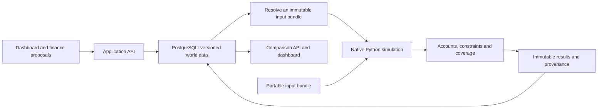

# Timeline Lab model and database architecture

**Design recommendation · 25 October 2026 · Revision 0.2**

Build a database-backed world model with a native Python simulation engine. Design the domain schema and calculation rules together, prove them through a small executable scenario, then build the dashboard around that contract.

Excel independence is a user requirement. PostgreSQL is the recommended database, subject to the storage decision in D-007. No database has been provisioned and no engine has been implemented by this design update.

## 1. The model's foundation

Represent a world at a date as explicit state: entities, population, productive capacity, public cash, debt, private and public claims, institutions and legal rights. Dated events and policies generate flows and change the rules governing later periods.

The calculation has a stable conceptual interface:

`simulate(initial_state, dated_events, assumptions, external_shocks, model_version) → trajectories, financial_postings, checks, provenance`

Opening stocks change through flows, valuation effects and other explicitly classified changes. Each model module declares its units, geography, period resolution, dependencies, supported events and checks. Annual GDP and Treasury views are projections of these results.

Keep three kinds of rules distinguishable:

| Rule | Example | Treatment |
|---|---|---|
| Accounting identity | Closing cash reconciles with opening cash, receipts and payments. | Must hold within the declared numeric policy. |
| Contract or policy | A facility charges a stated interest rate; a tax schedule applies from a specified year. | Versioned, dated terms with identified parties and exceptions. |
| Behavioural assumption | Investment changes future productive capacity, or disruption changes trade and productivity. | Explicit equation, coefficient, lag, evidence and uncertainty; it can be compared with alternatives. |

A balanced financial model does not establish the economic effects of a policy. GDP responses require their own production, trade, price or growth equations. Begin with the explicit baseline assumptions and the minimum supported responses needed by the pilot; expand the endogenous model through tested modules. Mark exogenous GDP paths and absent responses visibly.

This approach supports wider timelines without requiring a complete general-equilibrium or agent-based world simulator in the first release.

## 2. Responsibilities of the components

The database owns durable identities, relationships, versions, sources and saved runs. The application resolves scenario inheritance, orchestrates jobs and publishes completed results atomically. The engine receives a complete input bundle and computes without a live database, UI or network service.

Economic equations belong in versioned Python modules. SQL handles storage integrity and queries. Avoid embedding simulation rules in SQL triggers or storing arbitrary executable formula strings in database rows. A parameter value can be data; changing the mathematical rule requires a new model version.

The finance skill supplies inspectable quantity proposals and derivations. Applying a proposal produces explicit inputs; it does not give a language model control of the arithmetic during execution.

## 3. Proposed database structure

Use one shared relational schema with immutable revisions and scenario overlays. The following are logical table groups, not completed SQL migrations.

| Table group | Main contents and relationships |
|---|---|
| Sources and artifacts | Source ID, original bytes or immutable location, SHA-256, citation and authority. Distinguish source observations from calculated results. |
| Entities and revisions | Stable entity ID; versioned country, Treasury, firm, household/sector or territory attributes; ownership and geographic definitions. |
| Scenario versions | Scenario ID, immutable version ID, pinned baseline and parent version, applied assumption-set version and source references. |
| Events and overlays | Target ID, operation, effective interval, preconditions and typed event payload. Preserve removed events as version history. |
| Assumptions and schedules | Quantity definition, dated values, units, price basis, evidence class, derivation, range and dependency references. |
| Instruments and rights | Loan, bond, grant, guarantee, treaty or concession terms, parties, ownership shares, effective dates and termination rules. |
| Accounts and postings | Account ownership/type, run and period, balanced transactions, links to the instrument/event and cash/accrual classification. |
| Experiments and runs | Selected scenario versions, external-shock specification, input/model/engine hashes, job state and immutable artifact references. |
| Metrics and observations | Metric definition plus run, entity/geography, period, value and missing-value reason. Store years as records, with no table per scenario. |
| Checks and provenance | Identity or constraint, residual/tolerance, coverage, source paths and dependency traces. |

Strongly typed relational columns carry identities, units, dates, money, ownership and key relationships. Validated JSONB payloads can hold event-specific extensions. Original uploaded files stay separate: PostgreSQL JSONB does not preserve whitespace, key order or duplicate object keys, so it cannot preserve an uploaded file's exact bytes or file hash. [PostgreSQL JSON types](https://www.postgresql.org/docs/current/datatype-json.html).

Use primary, foreign and unique keys for structural integrity. Same-row conditions can be database checks; aggregate ledger balance, cross-period stock reconciliation and model feasibility require transaction-level/application validation. PostgreSQL explicitly limits what a CHECK constraint can guarantee across rows. [PostgreSQL constraints](https://www.postgresql.org/docs/current/ddl-constraints.html).

Store monetary postings using an explicit decimal precision and rounding policy, backed by PostgreSQL NUMERIC and Python Decimal. Ratios and economic simulations may use floating point where the module declares tolerances. Decimal arithmetic does not eliminate rounding or uncertainty: non-terminating divisions, conversion and aggregation still need defined rules. [PostgreSQL numeric types](https://www.postgresql.org/docs/current/datatype-numeric.html), [Python Decimal](https://docs.python.org/3/library/decimal.html).

PostgreSQL adds a service to install, migrate and back up. That cost is justified if the Lab is to become a durable web application with background calculations and potentially multiple authors. SQLite remains a sound simpler option for a deliberately local product; it is not responsible for the prior Excel dependency. Its documentation distinguishes local application storage from a shared client/server store. [SQLite use cases](https://www.sqlite.org/whentouse.html).

Use one supported storage implementation initially. The model's file-bundle interface provides portability without maintaining two database backends.

## 4. Timeline branching and time

A fork records a parent version and a small set of changes. It does not copy every table. Shared entity and contract records must be immutable revisions: a later correction must never change an old run indirectly.

The resolver walks the pinned ancestry, checks conflicts and materializes a complete input bundle. That bundle includes every referenced quantity, rule version and condition required by the engine. Hash the resolved content; retain the lineage and original files separately for audit.

Record both the period when a change applies in the fictional world and the time a revision was saved. These are different facts. A full bitemporal database or distributed event-sourcing platform is not required. A world event such as a treaty is also distinct from an application event such as saving a draft.

Within each period, evaluate modules in their declared order using valid opening state and effective events. Feedback loops need a documented lag or an explicit solver with convergence criteria. Any numerical solver is an implementation of an agreed model equation, not a source of political or economic assumptions.

The engine produces new trajectories. Old results remain attached to their original version, including when a later run fails.

## 5. Example of a useful first calculation

Use an illustrative reconstruction facility with a changed disbursement date. The quantities in this example would be selected as test inputs, not treated as Pacifica canon.

1. Save a baseline and a fork containing the revised facility schedule.
2. Resolve its lender, borrower, public/private shares, currency, draws, interest and repayment terms.
3. Compute the lender's cash outflow and claim, and the borrower's cash receipt and liability. Principal is a financial transaction; it is not automatically expenditure or GDP.
4. Carry interest, repayments, losses and any legally extinguished debt into later periods. A creditor write-down alone does not automatically extinguish the borrower's legal obligation.
5. Apply separately declared investment/output effects only if the recipient spends the funds through a supported programme with explicit productivity and timing assumptions.
6. Compare debt, cash, claims, interest and any supported GDP response; show a coverage gap if the output effect is unmodelled.

This tests the schema and engine together. A database containing only annual GDP totals could display the old answer but could not calculate this change.

A similar contract can later handle public works, mobilisation, migration, trade access or concessions. Each new family must describe its effects and constraints; narrative prose alone is insufficient execution input.

## 6. Native engine and the six existing cases

Implement the financial and economic rules as named modules, rather than translating worksheet addresses into the application model:

- Treasury: revenue, expenditure, cash policy and financing.
- Debt and claims: draws, issue prices, interest, maturity, repayments, losses and ownership.
- GDP and prices: explicitly named growth/production and price rules, with source/calibration status.
- Programmes and rights: cost schedules, capacity effects, dated entitlements and receipts.
- Constraints and checks: funding, supported physical limits, cross-account reconciliation and timing.

The workbook can be inspected and parsed read-only during migration to identify initial values and source equations. That is a one-time evidence extraction step. No production run, CI job or new-scenario calculation may depend on Excel, Office COM, a spreadsheet recalculation library or a remote spreadsheet service.

The six JSON bundles remain frozen regression evidence. Their outputs do not by themselves specify every equation or initial condition. Before implementation, inventory the source equations and assumptions, map each output to a native module and identify gaps. Preserve the old adapter for audit, not as a test executable.

The native engine must compare every declared pilot output, including all 87 years, 73 annual metrics, 17 labelled runs and supplied finer schedules. Reconcile intended differences openly. If a source equation is corrected, retain the legacy fixture and record both the expected corrected result and the reason. Fitting all six cases is an equivalence check, not empirical validation of the world model.

Run the engine in clean Windows and Linux environments without Office. Include changed inputs that are absent from the frozen bundles; a cached-result reader is insufficient.

## 7. Build order and release decision

| Stage | Concrete result |
|---|---|
| Domain and evidence | Pin exact source files; specify quantities, accounts, event contracts and a minimal relational schema. |
| Native vertical slice | Save a baseline/fork, resolve inputs, calculate one loan and one spending change from the command line, and reconcile the result. |
| Pilot coverage | Implement the native modules needed by all six cases and resolve every regression difference. |
| API and dashboard | Expose the proven model through import, edit, run, inspect and compare workflows. |
| Wider world model | Add event families and economic/physical modules with their own acceptance examples. |

The recommended stack is PostgreSQL, Python, FastAPI and React/TypeScript. Keep JSON as the exchange format. A separate graph database, analytical warehouse or microservice fleet is unnecessary for the pilot.

The additional upfront work is extracting and testing the model. The resulting engine is independently runnable, the database can evolve through migrations, and the dashboard can change without redefining the calculations.

Related requirements: TL-028 and TL-037–TL-040 in [backlog.json](backlog.json). Product scope and release gates remain in [requirements.md](requirements.md); frozen evidence is identified by [fixture-manifest.json](fixture-manifest.json).
