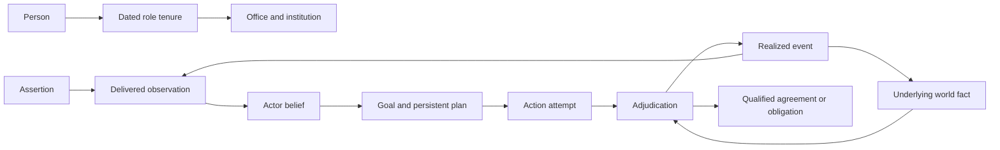

# Pacifica Timeline Lab ontology

**Semantic contract · 25 October 2026 · Revision 0.6**

The ontology defines what the Lab's records mean, which relationships are legal to represent, and how actions change a branch. Typed Python models, runtime arrays and result tables must preserve these meanings. The [requirements](requirements.md) and [backlog](backlog.json) define release obligations; the [structured catalog](draft-model-catalog.json) mirrors the record and invariant register under `ontology_contract`.

The contract is a design specification. Executable schemas, validators, bindings and mechanisms remain implementation work. R0 implements only the records and effects needed for one financing/commitment dilemma, selected character intentions and its supported consequences. Additional fields or types do not become executable merely because they can be stored.

## Semantic layers and authority

| Layer | Meaning |
|---|---|
| World | Entities, dated roles, quantities, underlying facts, qualified rights, obligations, forces and routes |
| Actor information and intention | Delivered observations, actor-specific beliefs, goals, persistent plans and commitments |
| Mechanism | Action types, eligibility, adjudication, observation rules, transitions, resource resolution and applicability |
| Experiment | Policies, profiles, interventions, narrative queries, campaigns, checkpoints, assessments and bookmarks |
| Provenance and explanation | Sources, assumptions, versions, typed support links, author reviews and narration claims |

Actor information and intention are a bounded semantic sublayer, not a second omniscient world. Author queries can inspect the saved full history; that access cannot flow into an actor's decision inputs.

Keep authorial authority (APPROVED, PROPOSED, OPEN or MODEL where used by the project), evidential strength and generated-result status separate. Approval of a starting fact does not calibrate a response probability. Model output does not approve canon. Existing character identities are referenced through their stable registry IDs or an explicit crosswalk; this document establishes no new character facts.

## Common record contract

Every record has a stable `id`, `record_type`, `contract_version`, explicit `scope` and `provenance_refs`. Scope identifies catalog definitions, a branch or a run, including parent references. References include the referenced version or resolve through the immutable input bundle; an unversioned name is not a reproducible link.

Dates use the declared fictional calendar and resolution, independent of host timezone. Effective intervals are half-open `[start, end)`; an absent end means open-ended only where the type permits it. Date uncertainty needs explicit bounds and a resolution rule. A historical year label is an aggregation period, not an exact event timestamp.

Separate effective/valid time, event time, sent/received time, actor-known time and author-recorded time. Announcing a future policy can affect beliefs before implementation; merely saving a future-effective parameter cannot. Events at one timestamp have registered phase/round ordering.

Values are typed and carry units, scope and price/currency basis where relevant. Predicates declare subject/object types and cardinality. Missingness distinguishes unknown, not applicable, unmodeled and explicitly absent. Refusal is a recorded outcome, not a missing consent field. Disputed claims remain separate assertions; material unresolved world truth must be branched into declared hypotheses or withheld from mechanisms requiring it.

## Record register

Required fields below are semantic obligations in addition to the common fields. Implementations may normalize them across linked records; they must preserve identity, meaning and replay.

| Record | Meaning | Required fields |
|---|---|---|
| Entity | Person, office, institution, faction, community or other distinct bearer of identity. | `kind`, `identity_refs`, `active_interval`, `name_history` |
| RoleTenure | A dated relation between a person or collective and an office/institution. | `holder_id`, `role_id`, `institution_id`, `valid_interval`, `authority_ref` |
| Proposition | A typed statement whose truth or belief can be evaluated. | `subject_refs`, `predicate_id`, `object_or_value_type`, `units_or_domain` |
| WorldFact | A branch-scoped underlying state assertion used by adjudication. | `proposition_id`, `value`, `resolution_status`, `valid_interval`, `mechanism_or_resolution_ref` |
| Assertion | A source claim or public/private statement that may be false. | `speaker_or_source_id`, `proposition_id`, `asserted_value`, `made_at`, `audience_refs`, `evidence_status` |
| Observation | Information actually delivered to a recipient. | `recipient_id`, `payload_refs`, `event_time`, `sent_at`, `received_at`, `channel_rule_id`, `visibility` |
| Belief | An actor's representation of a proposition. | `actor_id`, `proposition_id`, `believed_value`, `known_since`, `observation_refs`, `update_rule_id`, `confidence_kind` |
| Goal | An actor objective or selected personal intention. | `owner_id`, `beneficiary_refs`, `predicate_or_metric_ref`, `priority_or_preference_ref`, `active_interval`, `origin_ref` |
| Plan | A persistent course of intended action. | `owner_id`, `goal_refs`, `belief_refs`, `intended_action_refs`, `status`, `status_reason_refs`, `valid_interval` |
| Commitment | A promise or political undertaking distinct from legal liability. | `promisor_id`, `promisee_refs`, `content_ref`, `made_at`, `conditions`, `status`, `consequence_rule_id` |
| Agreement | A qualified multiparty instrument governing rights and obligations. | `party_roles`, `subject_refs`, `terms_ref`, `approval_refs`, `authority_refs`, `valid_interval`, `termination_rule_id`, `status` |
| Obligation | A duty or claim with explicit bearer and beneficiary. | `obligor_id`, `beneficiary_refs`, `instrument_or_event_ref`, `performance_or_payment_schedule`, `conditions`, `valid_interval`, `discharge_rule_id` |
| ActionAttempt | A chosen attempt based on actor-visible state. | `initiator_id`, `action_type_id`, `target_refs`, `parameters`, `chosen_at`, `observation_snapshot_ref`, `eligibility_rule_id`, `plan_refs`, `profile_ref` |
| Adjudication | The registered resolution of one or more attempts. | `attempt_refs`, `phase_id`, `rule_version`, `actual_precondition_refs`, `legal_status`, `disposition`, `reservation_refs`, `event_refs`, `disclosure_rule_id` |
| RealizedEvent | An actual modeled transition or explicitly imposed conditional event. | `event_type_id`, `happened_at`, `participant_refs`, `state_change_refs`, `cause_refs`, `generated_by`, `origin_kind` |
| Reservation | A claim on scarce resources pending settlement. | `owner_id`, `resource_id`, `amount_and_units`, `competing_attempt_refs`, `allocation_rule_id`, `valid_interval`, `status` |
| MechanismContract | Versioned dynamics and their domain of applicability. | `inputs`, `outputs`, `read_set`, `write_set`, `units`, `clock`, `lag_or_solver`, `applicability_predicate_ref`, `evidence_refs`, `uncertainty_ref`, `test_refs`, `unsupported_behavior` |
| ExplanationLink | A typed, scoped explanation relation. | `from_refs`, `to_refs`, `relation_kind`, `support_refs`, `mechanism_version`, `epistemic_status` |
| DecisionCheckpoint | A complete state from which a decision can be resumed. | `parent_run_id`, `decision_phase`, `prefix_hash`, `world_state_ref`, `actor_state_ref`, `queue_refs`, `obligation_refs`, `observation_refs`, `draw_plan_ref`, `engine_environment_ref` |
| Intervention | A declared change with counterfactual lineage. | `parent_checkpoint_or_version_ref`, `mode`, `target_refs`, `operations`, `effective_time`, `information_effect_refs`, `permitted_prefix_change`, `assumption_refs` |
| NarrativeQuery | An author request over histories, separate from policy utility. | `predicate_refs`, `temporal_order`, `search_mode`, `allowed_interventions`, `evidence_constraints`, `budget`, `selection_denominator`, `change_cost_contract` |
| StoryBookmark | An author-retained policy or history independent of search pruning. | `policy_or_history_ref`, `narrative_query_ref`, `author_rationale`, `assumption_refs`, `assessment_refs`, `profile_and_intervention_refs`, `saved_at` |
| AuthorReview | Evidence that the tool supports declared writing tasks. | `task_set_ref`, `protocol_version`, `author_judgments`, `timings`, `retained_idea_refs`, `repair_notes`, `acceptance_decision` |

## Invariant register

**ONT-01 Identity and succession.** Name equality never merges entities. Dated role changes preserve institution/person ownership and require explicit transfer or succession rules.

**ONT-02 Qualified relationships.** Rights, consent and obligations name participants, subject, authority, conditions and dates. Practical control and legal title remain independent.

**ONT-03 Truth and information.** Assertions, branch truth, observations and beliefs are separate. Unknown, absent, false/refused, disputed and unmodeled are not interchangeable.

**ONT-04 Time and branch.** Use explicit branch/run scope; valid/effective time, information receipt and author record/save time are distinct. Preserve an established prefix unless a declared earlier fork changes it.

**ONT-05 Intentionality.** Goals and plans belong to named actors and have supported update reasons. Unrealized intentions do not count as events or outcomes.

**ONT-06 Observation isolation.** Policy inputs, eligibility masks, previews, validation messages and response search knowledge obey the same observation boundary; hidden policy code is not public by default.

**ONT-07 Adjudication and conservation.** Attempts, resolutions and effects are distinct. Reservations and settlement conserve owned resources and follow registered phases independent of incidental iteration order.

**ONT-08 Legality profiles.** Lawful and breach profiles are explicit. Executable breaches need modeled consequences; neither profile relaxes physical invariants or locked authorial premises.

**ONT-09 Applicability and status propagation.** Runtime validity failures and selected provisional assumptions propagate to affected claims. Conditional/error paths remain counted and cannot silently enter stronger rankings.

**ONT-10 Explanation scope.** A causal claim needs a registered mechanism or declared intervention analysis; associations, prerequisites and author interpretations remain separately typed.

**ONT-11 Narrative and strategic selection.** Author conditions and bookmarks are independent of actor utilities and strategic pruning. Selected-history frequencies retain their denominator and cannot imply ordinary success probabilities.

**ONT-12 Replay and retention.** Decision-state reconstruction preserves latent actor/world state, queues, obligations and draw identities. Saved bookmarks and results keep referenced assets reachable.

## Identity and qualified relationships

An officeholder can simultaneously occupy several offices with different legal powers. An institution can outlive its leaders, split, merge or dissolve. Formation and succession events identify assets, population, debts, promises and rights that continue, transfer, lapse or remain disputed; they cannot silently reset history.

An Agreement contains role-qualified parties rather than a single undifferentiated actor pair. Roles can include obligor, creditor, beneficiary, owner, sovereign, ratifier and local rights holder. Consent is scoped to a named proposal/version and terms. Consent to one instrument is not consent to every later amendment.

Legal right, physical access, effective control, available capacity and willingness to cooperate have separate predicates. An illegal occupation can change control without creating lawful title. A failed offer can incur costs without creating a loan or an alliance.

## Belief and intention updates

A Proposition identifies a question such as whether a facility will be funded. WorldFact records the adjudicator's branch state. Assertions record what sources or actors claim. An Observation records delivery to a particular recipient; the registered update rule then produces a Belief.

For the same proposition, actors may have different beliefs and different confidence. A confidence scale is either explicitly qualitative or supported by a declared probability interpretation. Confidence is not automatically a historical likelihood.

Goals distinguish institutional objectives from selected personal commitments. Plans link goals to intended actions and supporting beliefs. Persist plan status as active, suspended, abandoned, achieved or failed, with a reason reference and effective time. A change in belief may change a plan; it need not erase a competing promise or obligation.

R0 models only consequential propositions, plans and persons selected for the dilemma. Unsupported personality, emotions and private motives remain author interpretations. A reviewed character profile is a scenario assumption unless canon establishes it. The optimizer retains the declared Pacifica control mask; selecting a character perspective does not control that character's foreign counterparts.

The distinction between author goals and actor intentions/beliefs is informed by [Sabre](https://ojs.aaai.org/index.php/AIIDE/article/view/18896). Preserving conflicting, unrealized plans is informed by [CPOCL](https://ojs.aaai.org/index.php/AIIDE/article/view/12428). Pacifica does not adopt their centralized omniscient planner as its actor controller.

## Action and adjudication protocol

An action definition declares parameters, perceived-eligibility rules, actual preconditions, authority rules, resource claims, delays, effects, possible dispositions and observation rules. Define the scope of each rule: actor-visible eligibility is different from adjudicator-only truth.

The registered step protocol is:

1. Apply events due in the current phase, mature queues and deliver observations scheduled for receipt.
2. Update beliefs and plans using only delivered information and the selected actor model.
3. Construct actor-visible eligibility and previews from that actor's permitted state. Collect simultaneous attempts against a frozen observation snapshot; declared negotiation rounds have their own order.
4. Resolve actual preconditions, authority, counterpart responses and competing resources. Create tentative reservations under a named allocation rule.
5. Commit an explicitly atomic bundle or its declared partial result; release reservations according to refusal, expiry and cancellation rules.
6. Advance implementation and settle dated effects. Record legal status separately from execution disposition, and check conservation and mechanism applicability.
7. Produce only the observations authorized for each recipient. Record outcomes and explanation links for author inspection.

This protocol may use several phases at the same timestamp. A module cannot reorder events implicitly. Feedback needs a declared lag or solver with convergence/failure behavior.

Action phases may include proposed, negotiating, authorized, committed, implementing, effective and closed. Refusal, deferral, partial execution, failure, exit and cancellation are explicit dispositions. A breach can bypass lawful authorization only under its selected profile and a registered transition; it never receives an invented authorization record.

Actual preconditions can be false although an attempt was reasonable given the actor's beliefs. Do not remove that attempt from the actor's menu using hidden facts. Validate pre-resolution messages, previews, action masks and automatic alternatives for the same isolation rule as policy inputs. Internal adjudication diagnostics are not automatically delivered to actors.

Resource resolution specifies priority, deterministic ties or addressed random ties; the choice is a model assumption. No ordering by arbitrary actor ID or worker completion may silently decide who receives scarce funds. Rationing and conditional agreements declare partial versus atomic settlement. Shared financing references prevent duplicate capital creation or double allocation.

## Profiles and constraint classes

| Class | Meaning in both profiles |
|---|---|
| Engine invariant | Arithmetic, resource conservation and semantic consistency; failure is a model error. |
| Physical limit | Actual resources, technology and time; an attempt can fail, but execution cannot create impossible capacity. |
| Legal requirement | Authority, consent, rights and duties; lawful execution requires them. |
| Authorial constraint | A locked premise of the experiment, including inherited project constraints. Changing it requires a separately permitted premise branch. |
| Policy or outcome bound | A declared choice restriction or result criterion; adverse outcomes remain in the population. |
| Applicability/evidence gate | A limit on what a mechanism or result can support. |

The `lawful` profile permits only lawful execution. A perceived authorization subsequently discovered invalid needs a declared error/discovery/consequence mechanism; the engine cannot relabel unlawful conduct as lawful.

The `breach_exploration` profile enables only specified physically possible breaches with explicit resistance, enforcement, institutional and obligation consequences. A missing consequence model disables that breach family. Counterpart refusal remains independent. Later consent, indemnity or cure changes later status while preserving the prior breach interval.

R0 demonstrates one selected supported comparison; it does not model all constitutional or coercive conduct. Existing authorial premises remain binding. A profile cannot grant another actor's consent or create private/public resources by declaration.

## Mechanisms and applicability

MechanismContract identifies typed inputs/outputs, read/write ownership, units, clocks, lags/solvers, parameters, evidence, structural alternatives, uncertainty and tests. Record an applicability predicate over state, attempted actions and relevant history. Name valid institutional regimes and material scale/time bounds; an existing input field does not establish applicability.

Run these predicates at initialization and before/after relevant transitions. Reject conflicting writers unless an explicit resolver combines their effects. Record the first failed predicate and propagate unsupported status along its dependent claims. Preserve unaffected results under their own scope.

Default behavior withholds affected computation or stops the affected path. An author may explicitly select a registered provisional replacement/continuation with typed inputs, limits, rationale and uncertainty. This produces a new linked conditional branch; it cannot invent an unavailable state merely to keep running.

Conditional histories remain available for creative exploration and in the total attempted-path accounting. Separate their results from ordinary supported rankings. Bound unresolved outcomes when justified; otherwise withhold the affected aggregate. Keep structural-model assessments separate unless an explicit weighting contract supports pooling.

## Decision checkpoints and interventions

A checkpoint is taken at a named phase, normally after permitted observations and before the controlled decision. It includes or reconstructs physical/financial stocks, roles/rights/obligations, queues and reservations, actor memories/beliefs/goals/plans, observation histories, pending reports and indexed random draws. Pin engine/environment and parent prefix hashes.

Unchanged resumption must reproduce the parent's logical events and numerical values under the existing tolerance contract. Stable logical IDs preserve draw identity when unrelated branches activate new objects.

| Mode | Change allowed | Interpretation |
|---|---|---|
| decision | A supported Pacifica attempt or policy rule at the selected decision, within the control mask | An alternative choice using the established information and past |
| premise | Declared state, mechanism or information assumptions at specified effective dates | A different scenario; earlier causes require an earlier fork |
| imposed_event | An explicit event injected with its required state effects and evidence/assumptions | A conditional author experiment, not evidence the policy generated the event |

All modes preserve immutable lineage. No mode silently changes the established prefix. An event at the fork that requires an earlier cause either declares an admissible external intervention or moves the fork earlier. Keep matched exogenous uncertainty where the design permits it and recompute endogenous consequences.

Ordinary policy assessment excludes forced future outcomes. An imposed event may help explore consequences, but it cannot certify a policy's probability of causing that event. Show the first material divergence, changed information and typed support links.

## Narrative queries and author retention

NarrativeQuery is an author-level selection/search contract. It names event/trajectory predicates, temporal order, allowed interventions, evidence/plausibility constraints and budget. Actors never receive the future predicate as hidden information.

R0 supports filtering and bookmarking recorded paths in the bounded slice. R1 adds route search and minimum-change search within registered policy/premise spaces. A minimum-change request needs a metric with units or a lexicographic order, allowed fields, bounds and tie handling. Describe results as best-found unless the bounded space was exhaustively checked.

Keep actor utility, strategic objectives and author narrative conditions separate. A policy can be dominated strategically and still be useful to the author. StoryBookmark preserves its immutable assets and assumptions independently of Pareto pruning, archive cells and clustering; ordinary artifact cleanup must retain those references.

Report the denominator of filtered or targeted histories. A high share among selected successful routes says nothing by itself about ordinary success frequency. Freeze a discovered policy and evaluate fresh unconditioned worlds before making its usual distributional claims.

## Explanation and narration

ExplanationLink distinguishes prerequisite, resource dependency, modeled effect, observation update, association and author interpretation. Record exact support, producing mechanism and scope. Model causal effects are claims within the declared model; chronology or a shared random seed alone does not prove causation.

A trace can explain why a character acted using its stored belief, intention and competing commitments. It need not claim access to unmodeled psychology. Deterministic summaries remain authoritative. Optional R2 narration renders supported claims and clearly separates author interpretation.

## Semantic relationships

Arrows identify typed references or registered transitions, not automatic causal effects. Adjudication can inspect underlying facts; an actor receives only the observations authorized by the observation rule.

## Bounded example

This example is a proposed synthetic acceptance case, not a Pacifica event or character fact.

| Phase | Record and meaning |
|---|---|
| Before a report | A lender's actual available funds are constrained. A source asserts that sufficient funds are available; the assertion does not change cash. |
| After delivery | A named officeholder receives the report and adopts a belief through the selected update rule. Another institution has not received it and retains its earlier belief. |
| At the decision | A plan supports an offer using that belief. The menu cannot secretly remove the offer using the lender's actual funds. |
| During adjudication | The lender responds independently; a registered rule can refuse, delay or partially fund. Reservations prevent the same funds backing two offers. |
| After disclosure | A permitted report explains the available result. The officeholder revises the plan while any surviving promise or legal duty remains separately recorded. |
| Author branch | The author can change the Pacifica attempt, alter the report's arrival as a premise, or impose funding as a conditional event; these produce three differently labeled experiments. |

A separate authority test compares lawful rejection with one explicitly supported unauthorized commitment and its consequences. That test cannot supply a counterparty signature or create lawful rights by assertion.

## Release evidence

R0 exercises identity/succession, unknown/disputed consent, selected belief/plan updates, observation-safe menus, shared-resource settlement, one lawful/breach comparison, full decision resumption, narrative bookmarks and applicability propagation. R1 adds bounded narrative-condition search and repeated author evaluation; R2 adds broad authoring/generation and optional prose.

The [backlog](backlog.json) contains Given/When/Then criteria TL-068–076 and demonstrations 15–22. The first author review uses predeclared real writing questions and records useful ideas, causal variety, agency, branch clarity, time to a retained idea and manual repair. A missing author acceptance decision cannot be replaced by throughput or an automated story score.
