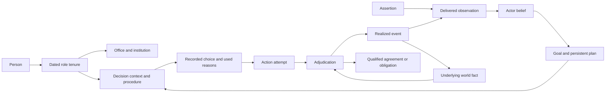

# Pacifica Timeline Lab ontology

**Semantic contract · 25 October 2026 · Revision 0.7**

The ontology defines what the Lab's records mean, which relationships are legal to represent, and how actions change a branch. Typed Python models, runtime arrays and result tables must preserve these meanings. The [requirements](requirements.md) and [backlog](backlog.json) define release obligations; the [structured catalog](draft-model-catalog.json) mirrors the record and invariant register under `ontology_contract`.

The contract is a design specification. Executable schemas, validators, bindings and mechanisms remain implementation work. R0 implements only the records and effects needed for one financing/commitment dilemma, selected character intentions and its supported consequences. Additional fields or types do not become executable merely because they can be stored.

## Semantic layers and authority

| Layer | Meaning |
|---|---|
| World | Entities, dated roles, quantities, underlying facts, qualified rights, obligations, forces and routes |
| Actor information and intention | Delivered observations, actor-specific beliefs, goals, persistent plans and commitments |
| Mechanism | Action types, eligibility, adjudication, observation rules, transitions, resource resolution and applicability |
| Experiment | Policies, profiles, interventions, narrative queries, campaigns, checkpoints, assessments and bookmarks |
| Provenance and explanation | Sources, assumptions, versions, typed support links, author reviews and narration claims |

Actor information and intention are a bounded semantic sublayer, not a second omniscient world. Author queries can inspect the saved full history; that access cannot flow into an actor's decision inputs.

Keep authorial authority (APPROVED, PROPOSED, OPEN or MODEL where used by the project), evidential strength and generated-result status separate. Approval of a starting fact does not calibrate a response probability. Model output does not approve canon. Existing character identities are referenced through their stable registry IDs or an explicit crosswalk; this document establishes no new character facts.

## Common record contract

Every record has a stable `id`, immutable `revision_id`, `record_type`, `contract_version`, explicit `scope`, `provenance_refs`, `recorded_at` and nullable `supersedes_ref`. Scope identifies catalog, branch or run with parent references. Links pin revisions or resolve through a retained immutable bundle. Revisions append; later corrections never mutate the observation payload or decision snapshot that an earlier actor used.

Dates use the declared fictional calendar/resolution, independent of host timezone. Effective intervals are half-open `[start, end)`; open ends are permitted only by type. Date uncertainty needs bounds and a resolution rule. A year label is an aggregation period, not an exact event timestamp.

Separate the proposition's target time, a fact's valid time, the interval during which an actor holds a belief, event time, sent/received time and author/engine record time. Announcing a future policy can change beliefs before implementation; saving a future parameter cannot. Events at one timestamp have registered phase ordering.

Values carry types, units, scope and currency/price basis where relevant. Unknown, not applicable, unmodeled, explicitly absent, false and refusal differ; disagreement belongs to separately supported assertions. Material unresolved world truth is branched into declared hypotheses or withheld from mechanisms requiring it. An empty collection or null is allowed only by its type: spontaneous bookmarks may omit query/candidate references; personal-capacity decisions may omit a represented institution; initial revisions have no predecessor; queries without change-cost ranking need no change cost.

## Record register

Required fields below are semantic obligations in addition to the common fields. Linked records may normalize these fields while preserving identity, meaning and replay. Nullable fields must be present with explicit null where their contract permits it.

| Record | Meaning | Required fields |
|---|---|---|
| Entity | Person, office, institution, faction, community or other distinct bearer of identity. | `kind`, `identity_refs`, `active_interval`, `name_history` |
| RoleTenure | A dated relation between a person or collective and an office/institution. | `holder_id`, `role_id`, `institution_id`, `valid_interval`, `authority_ref` |
| Proposition | A grounded typed question about explicitly bound entities and a target time or interval. | `predicate_id`, `argument_bindings`, `target_interval`, `value_domain_ref` |
| WorldFact | A branch-scoped underlying state assertion used by adjudication. | `proposition_id`, `value`, `resolution_status`, `valid_interval`, `state_key`, `mechanism_or_resolution_ref` |
| Assertion | A source claim or public/private statement that may be false. | `speaker_or_source_id`, `proposition_id`, `asserted_value`, `made_at`, `audience_refs`, `evidence_status` |
| Observation | Information actually delivered to a recipient. | `recipient_id`, `payload_snapshot_ref`, `payload_hash`, `event_time`, `sent_at`, `received_at`, `channel_rule_id`, `visibility` |
| Belief | An actor's representation of a proposition. | `actor_id`, `proposition_id`, `believed_value`, `belief_interval`, `observation_refs`, `update_rule_id`, `confidence_kind` |
| Goal | An actor objective or selected personal intention. | `owner_id`, `beneficiary_refs`, `predicate_or_metric_ref`, `priority_or_preference_ref`, `active_interval`, `origin_ref` |
| Plan | A persistent course of intended action. | `owner_id`, `goal_refs`, `belief_refs`, `intended_action_refs`, `status`, `actual_goal_status`, `status_reason_refs`, `reason_kind`, `valid_interval` |
| Commitment | A promise or political undertaking distinct from legal liability. | `promisor_id`, `promisee_refs`, `content_ref`, `made_at`, `conditions`, `status`, `consequence_rule_id` |
| Agreement | A qualified multiparty instrument governing rights and obligations. | `party_roles`, `subject_refs`, `terms_ref`, `approval_refs`, `authority_refs`, `valid_interval`, `termination_rule_id`, `status` |
| Obligation | A duty or claim with explicit bearer and beneficiary. | `obligor_id`, `beneficiary_refs`, `instrument_or_event_ref`, `performance_or_payment_schedule`, `conditions`, `valid_interval`, `discharge_rule_id` |
| ActionAttempt | A chosen attempt based on actor-visible state. | `initiator_id`, `decision_record_ref`, `action_type_id`, `target_refs`, `parameters`, `chosen_at`, `observation_snapshot_ref`, `eligibility_rule_id`, `plan_refs`, `profile_ref` |
| Adjudication | The registered resolution of one or more attempts. | `attempt_refs`, `phase_id`, `rule_version`, `actual_precondition_refs`, `perceived_authorization_ref`, `actual_legal_status`, `disposition`, `reservation_refs`, `event_refs`, `disclosure_rule_id` |
| RealizedEvent | An actual modeled transition or explicitly imposed conditional event. | `event_type_id`, `happened_at`, `participant_refs`, `state_change_refs`, `cause_refs`, `generated_by`, `origin_kind` |
| Reservation | A claim on scarce resources pending settlement. | `owner_id`, `resource_id`, `amount_and_units`, `competing_attempt_refs`, `allocation_rule_id`, `valid_interval`, `status` |
| MechanismContract | Versioned dynamics and their domain of applicability. | `inputs`, `outputs`, `read_set`, `write_set`, `units`, `clock`, `lag_or_solver`, `applicability_predicate_ref`, `evidence_refs`, `uncertainty_ref`, `test_refs`, `unsupported_behavior` |
| ExplanationLink | A typed, scoped explanation relation. | `from_refs`, `to_refs`, `relation_kind`, `support_refs`, `mechanism_version`, `epistemic_status` |
| DecisionCheckpoint | A complete state from which a decision can be resumed. | `parent_run_id`, `decision_phase`, `prefix_hash`, `world_state_ref`, `actor_state_ref`, `queue_refs`, `obligation_refs`, `observation_refs`, `draw_plan_ref`, `engine_environment_ref` |
| Intervention | A declared change with counterfactual lineage. | `parent_checkpoint_or_version_ref`, `mode`, `target_refs`, `operations`, `effective_time`, `information_effect_refs`, `permitted_prefix_change`, `assumption_refs` |
| NarrativeQuery | An author request over histories, separate from policy utility. | `predicate_refs`, `temporal_contract_ref`, `search_mode`, `target_quantification`, `allowed_interventions`, `sampling_contract_ref`, `evidence_constraints`, `budget`, `population_ref`, `change_cost_contract` |
| StoryBookmark | An author-retained policy or history independent of search pruning. | `policy_or_history_ref`, `story_candidate_ref`, `narrative_query_ref`, `selection_reason`, `author_rationale`, `assumption_refs`, `assessment_refs`, `profile_and_intervention_refs`, `saved_at` |
| AuthorReview | Evidence that the tool supports declared writing tasks. | `task_set_ref`, `protocol_version`, `held_out_task_ref`, `manual_comparator_ref`, `author_judgments`, `timings`, `retained_idea_refs`, `repair_notes`, `acceptance_decision` |
| PredicateDefinition | A versioned signature and state/query meaning for a supported predicate. | `argument_roles`, `value_domain`, `units_or_basis`, `temporal_kind`, `cardinality`, `state_key_rule`, `state_owner_ref`, `resolution_rule_ref`, `missingness_rule_ref`, `query_evaluation_rule_ref` |
| DecisionContext | The authority, information and decision procedure in force for a choice. | `decision_maker_id`, `acting_for_id`, `role_tenure_refs`, `authority_scope_refs`, `resource_owner_refs`, `control_binding_ref`, `information_snapshot_ref`, `goal_and_commitment_refs`, `decision_rule_ref`, `conduct_profile_ref` |
| DecisionRecord | An immutable record of a choice and the procedure that produced it. | `context_ref`, `considered_alternatives`, `selected_action_spec`, `used_belief_refs`, `used_goal_and_commitment_refs`, `tradeoff_or_rejection_refs`, `procedure_trace_ref`, `random_address_refs`, `selection_origin`, `chosen_at` |
| StoryCandidate | A derived, supported dramatic reading of an actual history, independent of strategic rank. | `history_ref`, `focal_actor_refs`, `goal_refs`, `obstacle_or_conflict_refs`, `decision_refs`, `sacrifice_refs`, `consequence_refs`, `unresolved_tension_refs`, `causal_signature`, `derivation_rule_ref`, `support_refs`, `assumption_refs`, `population_ref` |
| MetricSample | A numerical or qualitative measured result for author analysis, distinct from delivered actor information. | `run_id`, `metric_id`, `entity_or_geography_ref`, `period`, `value_or_missing_reason`, `units_or_basis`, `producing_mechanism_ref`, `coverage_status`, `population_ref` |
| EvaluationPopulation | The membership, selection and weighting contract for reported results. | `world_design_id`, `root_world_ids`, `evaluation_members`, `branch_lineage_refs`, `membership_rule`, `selection_rule_ref`, `weight_contract`, `status_counts`, `denominator_unit`, `parent_population_ref` |

## Invariant register

**ONT-01 Identity and succession.** Name equality never merges entities. Dated role changes preserve institution/person ownership and require explicit transfer or succession rules.

**ONT-02 Qualified relationships.** Rights, consent and obligations name participants, subject, authority, conditions and dates. Practical control and legal title remain independent.

**ONT-03 Truth and information.** Assertions, branch truth, observations and beliefs are separate. Unknown, absent, false/refused, disputed and unmodeled are not interchangeable.

**ONT-04 Time and branch.** Use explicit branch/run scope; valid/effective time, information receipt and author record/save time are distinct. Preserve an established prefix unless a declared earlier fork changes it.

**ONT-05 Intentionality.** Goals and plans belong to named actors and have supported update reasons. Unrealized intentions do not count as events or outcomes.

**ONT-06 Observation isolation.** Policy inputs, eligibility masks, previews, validation messages and response search knowledge obey the same observation boundary; hidden policy code is not public by default.

**ONT-07 Adjudication and conservation.** Attempts, resolutions and effects are distinct. Reservations and settlement conserve owned resources and follow registered phases independent of incidental iteration order.

**ONT-08 Legality profiles.** Conduct profiles bind named actors and action families. Strict lawful execution, supported apparent authority and intentional breach exploration are distinct; none relaxes physical invariants, independent consent or locked authorial premises.

**ONT-09 Applicability and status propagation.** Runtime validity failures and selected provisional assumptions propagate to affected claims. Conditional/error paths remain counted and cannot silently enter stronger rankings.

**ONT-10 Explanation scope.** A causal claim needs a registered mechanism or declared intervention analysis; associations, prerequisites and author interpretations remain separately typed.

**ONT-11 Narrative and strategic selection.** Open exploration and narrative candidate selection operate before strategic pruning. Author conditions and bookmarks are independent of actor utilities; targeted-history frequencies retain their population and cannot imply ordinary success probabilities.

**ONT-12 Replay and retention.** Decision-state reconstruction preserves latent actor/world state, queues, obligations and draw identities. Saved bookmarks and results keep referenced assets reachable.

**ONT-13 Predicate state and revisions.** Argument roles, target time, state keys and authoritative writers are registered. Immutable revisions and delivered snapshots preserve past facts and beliefs; out-of-order reports cannot silently rewrite them.

**ONT-14 Decision ownership and reasons.** Every attempt links a decision-maker, represented principal, dated authority, resource owners and executed decision rule. Reasons identify inputs actually used; author overrides remain explicit.

**ONT-15 Search and temporal interpretation.** Existential history search, policy reliability and premise change have distinct targets and evidence. Incomplete or unsupported histories cannot satisfy unresolved temporal conditions; budget exhaustion is not impossibility.

**ONT-16 Population accounting.** Every summary declares membership, counting unit, conditioning and weights. Retries and conditional descendants do not create independent root worlds or silently replace unsupported parent outcomes.

## Identity and qualified relationships

### Predicate state and revision rules

Each active PredicateDefinition names argument roles and types, value domain/units, temporal kind, cardinality, state-key construction, authoritative state owner, missingness/resolution and query-evaluation rules. The resolver rejects unknown roles, incompatible units and overlapping resolved values for a single-valued state key. Multivalued relations declare their cardinality and identity explicitly. Numeric arrays and WorldFact records are projections of one owned state through versioned bindings, never separately writable sources of truth.

A Proposition binds arguments and the period it concerns. Changing its target period creates a different proposition. WorldFact revisions may split effective intervals or explicitly supersede a prior resolution; a materialized snapshot selects exactly one applicable resolution per key/time/branch. Keep superseded records and their dependencies reachable. Belief revisions separately identify when the actor held each value about that same target period.

Observation carries a filtered immutable payload snapshot and hash. It may reference the exact delivered assertion revision; any author-only evidence/provenance remains outside actor dereference capability. An old report arriving late follows the declared credibility/temporal update rule, not an automatic last-arrival overwrite. Inferring current cash from an old report requires an explicit projection rule and assumption.

MetricSample is an author-visible result keyed by run, metric, entity/geography and period. It is never an actor Observation by default; an observation channel must explicitly select, transform and deliver its permitted information.

### Persons and institutional capacity

An officeholder can simultaneously occupy several offices with different legal powers. An institution can outlive its leaders, split, merge or dissolve. Formation and succession events identify assets, population, debts, promises and rights that continue, transfer, lapse or remain disputed; they cannot silently reset history.

An Agreement contains role-qualified parties rather than a single undifferentiated actor pair. Roles can include obligor, creditor, beneficiary, owner, sovereign, ratifier and local rights holder. Consent is scoped to a named proposal/version and terms. Consent to one instrument is not consent to every later amendment.

Legal right, physical access, effective control, available capacity and willingness to cooperate have separate predicates. An illegal occupation can change control without creating lawful title. A failed offer can incur costs without creating a loan or an alliance.

## Belief and intention updates

A Proposition identifies a question at a target time. WorldFact supplies adjudicator state; Assertion records a possibly false claim; Observation records what was delivered; a registered rule updates Belief. Different actors may retain different beliefs and qualitative confidence. Numeric confidence needs a probability interpretation and does not automatically establish historical likelihood.

DecisionContext binds the decision-maker, represented institution or personal capacity, dated roles and authority, resource owners, control binding, information snapshot, selected goals/commitments and versioned decision procedure. An officeholder's personal property, memories and promises do not become institutional assets or liabilities on appointment. Succession specifies what transfers and what remains private.

The controller binding states which decisions the Pacifica policy supplies and which internal/independent procedures resolve. It must explain how selected personal and institutional preferences affect an executive choice. A policy cannot silently suppress an enabled personal-commitment model; changing that model is a declared premise change. M0 may use a small ordered decision rule or explicit preference procedure rather than a general personality engine.

DecisionRecord captures considered alternatives within that procedure's declared scope, the selected action, beliefs/goals/commitments actually used, trade-offs or rejection reasons, procedure trace and random addresses. Attaching a goal afterward does not establish a motive. Explanations identify `selection_origin` as actor procedure or author override. An overridden choice remains inspectable but receives no fabricated actor rationale.

Plans retain active, suspended, abandoned, achieved or failed owner assessments and a separately evaluated actual-goal status. A mistaken belief can make an actor think a goal is achieved while underlying truth differs. Reason kinds distinguish external frustration, voluntary abandonment, changed belief, resource failure and completed intention. A plan change does not erase a promise or obligation.

R0 models only consequential propositions, plans and persons selected for the dilemma. Unsupported personality and motives remain author interpretations; reviewed profiles are scenario assumptions unless canon establishes them. Reuse stable character IDs. Selecting a perspective does not expand control over counterparts.

The actor intention/belief distinction is informed by [Sabre](https://ojs.aaai.org/index.php/AIIDE/article/view/18896); preserving conflicting unrealized plans is informed by [CPOCL](https://ojs.aaai.org/index.php/AIIDE/article/view/12428). Their centralized planners are not adopted as Pacifica's actor controller.

## Action and adjudication protocol

An action definition declares parameters, perceived-eligibility rules, actual preconditions, authority rules, resource claims, delays, effects, possible dispositions and observation rules. Define the scope of each rule: actor-visible eligibility is different from adjudicator-only truth.

The registered step protocol is:

1. Apply events due in the current phase, mature queues and deliver observations scheduled for receipt.
2. Update beliefs and plans using only delivered information and the selected actor model.
3. Build a DecisionContext and actor-visible eligibility/previews from permitted information. Execute the pinned decision procedure, save its DecisionRecord, and collect simultaneous attempts against frozen snapshots; declared negotiation rounds have their own order.
4. Resolve actual preconditions, authority, counterpart responses and competing resources. Create tentative reservations under a named allocation rule.
5. Commit an explicitly atomic bundle or its declared partial result; release reservations according to refusal, expiry and cancellation rules.
6. Advance implementation and settle dated effects. Record legal status separately from execution disposition, and check conservation and mechanism applicability.
7. Produce only the observations authorized for each recipient. Record outcomes and explanation links for author inspection.

This protocol may use several phases at the same timestamp. A module cannot reorder events implicitly. Feedback needs a declared lag or solver with convergence/failure behavior.

Action phases may include proposed, negotiating, authorized, committed, implementing, effective and closed. Refusal, deferral, partial execution, failure, exit and cancellation are explicit dispositions. A breach can bypass lawful authorization only under its selected profile and a registered transition; it never receives an invented authorization record.

Actual preconditions can be false although an attempt was reasonable given the actor's beliefs. Do not remove that attempt from the actor's menu using hidden facts. Validate pre-resolution messages, previews, action masks and automatic alternatives for the same isolation rule as policy inputs. Internal adjudication diagnostics are not automatically delivered to actors.

Resource resolution specifies priority, deterministic ties or addressed random ties; the choice is a model assumption. No ordering by arbitrary actor ID or worker completion may silently decide who receives scarce funds. Rationing and conditional agreements declare partial versus atomic settlement. Shared financing references prevent duplicate capital creation or double allocation.

## Profiles and constraint classes

| Class | Meaning in every conduct profile |
|---|---|
| Engine invariant | Arithmetic, resource conservation and semantic consistency; failure is a model error. |
| Physical limit | Actual resources, technology and time; an attempt can fail but execution cannot create capacity. |
| Legal requirement | Authority, consent, rights and duties; legal status remains distinct from physical conduct. |
| Authorial constraint | A locked experiment premise; a permitted change requires a separate premise branch. |
| Policy or outcome bound | A declared choice restriction or result criterion; adverse outcomes remain counted. |
| Applicability/evidence gate | A limit on what a mechanism or claim can support. |

Conduct binds named actors or explicit actor sets and action families, with effective intervals, rule versions and overlap precedence. Missing bindings and unresolved overlap fail configuration. There is no experiment-wide assumption that all actors obey Pacifica's selected conduct restriction.

| Profile | Execution and information contract |
|---|---|
| lawful | Strict lawful execution for the bound conduct. Perceived eligibility remains observation-safe, but actual unauthorized execution is rejected; hidden reasons are disclosed only through the registered channel. Apparent-authority execution is excluded. |
| apparent_authority | A separately enabled, physically possible act believed authorized under the actor's pinned credibility rule may execute. Adjudication records actual illegality then; the actor learns it only through the registered discovery channel. Resistance, obligations, liability and cure need coverage. |
| breach_exploration | Only explicitly enabled intentional breaches may execute, with supported resistance, enforcement, institutional and obligation consequences. The actor's intent to violate differs from mistaken authorization. |

Pacifica can remain bound to lawful while an independent counterparty uses a supported different profile. The profile enables a family; the counterparty still chooses its own action. It does not create consent, title, resources or a favorable response. Unknown/disputed adjudicator truth requires a hypothesis or unsupported result where resolution is material; apparent authority is not permission to invent truth.

Later consent, indemnity or cure changes later status while preserving the earlier breach interval. R0 exercises one bounded exceptional-conduct/consequence family across its applicable profiles and a mixed-actor case; no general constitutional or coercive model is implied.

## Mechanisms and applicability

MechanismContract identifies typed inputs/outputs, read/write ownership, units, clocks, lags/solvers, parameters, evidence, structural alternatives, uncertainty and tests. Record an applicability predicate over state, attempted actions and relevant history. Name valid institutional regimes and material scale/time bounds; an existing input field does not establish applicability.

Run these predicates at initialization and before/after relevant transitions. Reject conflicting writers unless an explicit resolver combines their effects. Record the first failed predicate and propagate unsupported status along its dependent claims. Preserve unaffected results under their own scope.

Default behavior withholds affected computation or stops the affected path. An author may explicitly select a registered provisional replacement/continuation with typed inputs, limits, rationale and uncertainty. This produces a new linked conditional branch; it cannot invent an unavailable state merely to keep running.

Conditional histories remain available for creative exploration and in the total attempted-path accounting. Separate their results from ordinary supported rankings. Bound unresolved outcomes when justified; otherwise withhold the affected aggregate. Keep structural-model assessments separate unless an explicit weighting contract supports pooling.

## Decision checkpoints and interventions

A checkpoint is taken at a named phase, normally after permitted observations and before the controlled decision. It includes or reconstructs physical/financial stocks, roles/rights/obligations, queues and reservations, actor memories/beliefs/goals/plans, observation histories, pending reports and indexed random draws. Pin engine/environment and parent prefix hashes.

Unchanged resumption must reproduce the parent's logical events and numerical values under the existing tolerance contract. Stable logical IDs preserve draw identity when unrelated branches activate new objects.

| Mode | Change allowed | Interpretation |
|---|---|---|
| decision | A supported Pacifica attempt or policy rule at the selected decision, within the control mask | An alternative choice using the established information and past |
| premise | Declared state, mechanism or information assumptions at specified effective dates | A different scenario; earlier causes require an earlier fork |
| imposed_event | An explicit event injected with its required state effects and evidence/assumptions | A conditional author experiment, not evidence the policy generated the event |

All modes preserve immutable lineage. No mode silently changes the established prefix. An event at the fork that requires an earlier cause either declares an admissible external intervention or moves the fork earlier. Keep matched exogenous uncertainty where the design permits it and recompute endogenous consequences.

Ordinary policy assessment excludes forced future outcomes. An imposed event may help explore consequences, but it cannot certify a policy's probability of causing that event. Show the first material divergence, changed information and typed support links.

Retain predicate/revision maps, immutable delivered payloads, controller state, decision-context bindings, conduct rules and population lineage in the checkpoint or verified reconstruction. A decision override declares whether it changes one attempt or a continuing policy rule; subsequent plan updates follow the registered procedure. A permissible author override may lack an actor-supported motive and must retain that label.

## Narrative queries and author retention

### Open exploration and candidate selection

R0 supports exploration without a requested ending or strategic objective set. Every generated history, or its reconstructible compact trace, reaches a bounded candidate selector before strategic/Pareto pruning. It extracts supported causal features and keeps representatives under a registered capacity, coverage and eviction policy. A policy's strategic inferiority cannot itself exclude its story. Candidate metadata retains enough immutable inputs and draw/environment references to reconstruct shortlisted histories; bookmarks pin their assets independently.

Use causal signatures over focal actors/goals, conflicting commitments, externally frustrated plans, revelations, consequential choices and reversals. Numerical/date jitter alone is not a new dramatic route. Similar financial outcomes can contain different conflicts. Report the selector's examined population and omissions; bounded retention does not claim to preserve every interesting history. The R0 enumerable acceptance set includes a distinct dominated case that must be surfaced without naming its ending.

StoryCandidate is a derived dramatic view: actor, goal, obstacle/conflict, choice, sacrifice, consequence and unresolved tension, each linked to actual supports and assumptions. Missing elements stay unknown. A derived view cannot invent a goal, cause a world transition or replace author judgment. A spontaneous StoryBookmark permits null query/candidate references, records a selection reason and pins the actual history/policy.

### Search modes and result meaning

| Mode | Target and evidence |
|---|---|
| filter | Evaluate a predicate over a named existing population; no new search. |
| open_exploration | Surface varied generated causal possibilities with no required ending or strategic score. |
| existential_history | Find at least one supported generated witness satisfying the target under declared policies and sampling bounds. A witness makes no reliability claim. |
| policy_reliability | Compare target satisfaction across fresh unconditioned worlds for frozen policies. Probability language requires a supported probability model; otherwise report scenario coverage/robustness. |
| minimum_premise_change | Find allowed premise edits and a witness using declared units or lexicographic costs, bounds and ties. Compare premise packages separately; minimality needs exhaustive checking of the stated bounded space. |

R0 implements filtering, open exploration and temporal evaluation over its slice; R1 adds the three search modes. Each query declares quantification, temporal contract, allowed fields/interventions, sampling, evidence constraints, population and budget. Strategic objective sets and Pareto output apply only to strategic optimization; a reliability query can use its explicit target as the outcome measure.

Search mode differs from intervention mode.

An existential-history query may additionally rank permitted decision/policy edits by an explicit change-cost contract; units/order, bounds and tie rules are required. This preserves bounded minimum-decision-change exploration without conflating it with changing premises. Minimality still requires exhaustive evidence.

Decisions obey Pacifica's control mask and other actors' own procedures. Premise changes are separate scenario assumptions. Imposed events remain conditional consequence experiments and cannot certify a supported witness that a policy generated them. An author sampler may target or stratify declared uncertain conditions; it records selection and any proposal/weight contract. It does not tune favorable seeds as a policy variable or force counterpart compliance. Fresh unconditioned assessment is required for ordinary distributions of a selected policy.

Search results distinguish `found_supported`, `found_conditional`, `no_match_within_budget`, `unsatisfiable_within_exhaustive_scope` and `unsupported_query`. A failed heuristic search is not proof of impossibility. Keep unsuccessfully explored attempts and reasons available within the declared retention budget.

### Temporal predicate evaluation

The bounded query grammar names variable bindings, explicit half-open horizons, event existence/order, state-at-time and always/until conditions. Register quantification and aggregation; no arbitrary unreviewed code executes as a predicate. A year condition such as through 1932 resolves to the declared end boundary, normally 1 January 1933.

Return `satisfied`, `violated`, `unresolved` or `unsupported`. A supported positive event witness can satisfy an existential condition on a partial history; an absence or always condition requires coverage of its full horizon. No default through 1932 remains unresolved when observation stops in 1930. A supported counterexample can violate an always condition immediately. Relevant unmodeled mechanisms yield unsupported, not false. For until, require its supported endpoint witness and the preceding condition over the required interval; incomplete coverage is unresolved.

NOT exchanges satisfied/violated and preserves unresolved/unsupported. AND is violated by a decisive supported false operand; otherwise unsupported takes precedence over unresolved, then satisfied. OR is satisfied by a decisive supported true operand; otherwise unsupported takes precedence over unresolved, then violated. Record the operands supporting a decisive result and retain broader coverage warnings. Exhaustive-scope impossibility is available only when every allowed candidate is conclusively violated with the required coverage.

### Population and denominator identities

EvaluationPopulation declares world design/root IDs, policy/actor/mechanism/assessment membership, branch lineage, selection, weights and counting unit. A root-world ID denotes the sampled external conditions, not a policy, retry or branch. An evaluation key includes policy, actor/model versions, world design/root and assessment stage. Logical branch runs have their own identities; retries are execution attempts of the same evaluation.

100 root worlds with 20 unsupported paths and 20 provisional child continuations remain 100 original policy-world evaluations: 80 supported and 20 unsupported. There are 120 logical branch executions before retries. The 20 continuations form a selected conditional population, not 20 added independent worlds.

Preserve root status; report a continuation scenario separately. If justified outcome bounds exist, publish lower/upper aggregate bounds over the original population; otherwise withhold the affected aggregate. Retries, cache hits and reused evaluations are cost/accounting fields, not new evidence.

Targeted candidates, filters and conditional continuations have explicit child populations. A selected share is not an unconditional success rate. Distinguish original population size, completed/unsupported/error members, child branches, retries, cache reuse and actual compute cost.

## Explanation and narration

ExplanationLink distinguishes prerequisites, resource dependencies, modeled effects, observation updates, goal threats, plan frustration, opportunities and decision sacrifices from associations and author interpretations. Exact supporting revisions, producing mechanisms/derivations and scope are required. A conflict/threat is derived from registered goal/plan conditions and supported events; it creates no independent world effect.

Decision explanations cite inputs actually used by the recorded procedure and relevant rejected alternatives within its bounded consideration set. Show a character's believed consequences separately from actual consequences. External frustration of a plan differs from voluntary abandonment; a subsequent dilemma may be supported by the obligations and choices left open. Actor reasons are not omniscient psychological truth.

Deterministic R0 story-candidate templates expose focal actor, goal, obstacle, choice, sacrifice, consequence and unresolved tension with missing elements explicit. Optional R2 narration renders those supported claims and separates author interpretation. Chronology, a shared random seed or an attached goal alone cannot establish causation or motive.

## Semantic relationships

Arrows identify typed references or registered transitions, not automatic causal effects. Adjudication can inspect underlying facts; an actor receives only the observations authorized by the observation rule.

## Bounded example

This example is a proposed synthetic acceptance case, not a Pacifica event or character fact.

| Phase | Record and meaning |
|---|---|
| Before a report | A lender's actual available funds are constrained. A source asserts that sufficient funds are available; the assertion does not change cash. |
| After delivery | A named officeholder receives the report and adopts a belief through the selected update rule. Another institution has not received it and retains its earlier belief. |
| At the decision | A plan supports an offer using that belief. The menu cannot secretly remove the offer using the lender's actual funds. |
| During adjudication | The lender responds independently; a registered rule can refuse, delay or partially fund. Reservations prevent the same funds backing two offers. |
| After disclosure | A permitted report explains the available result. The officeholder revises the plan while any surviving promise or legal duty remains separately recorded. |
| Author branch | The author can change the Pacifica attempt, alter the report's arrival as a premise, or impose funding as a conditional event; these produce three differently labeled experiments. |

A separate authority test compares lawful rejection with one explicitly supported unauthorized commitment and its consequences. That test cannot supply a counterparty signature or create lawful rights by assertion.

Additional bounded checks deliver March reports out of order in June, replace an officeholder without transferring private motives or erasing institutional duties, and compare strict lawful rejection with apparent authority followed by discovery. These are synthetic tests, not new character or historical claims. Open exploration must surface two causally different histories with similar cash outcomes and retain a dominated candidate without an author-specified ending.

## Release evidence

R0 exercises the active subset of 29 record contracts and 16 invariants, including dated identity, predicate state ownership, out-of-order reports, actual decision reasons, observation-safe menus, settlement, actor-scoped conduct, decision resumption, open causal candidates, spontaneous bookmarks, temporal queries and population accounting. R1 adds distinct narrative search modes and repeated author evaluation. R2 retains general authoring/generation and optional prose.

The [backlog](backlog.json) preserves TL-001–076 and their acceptance IDs, strengthens the relevant contracts and adds demonstrations 23–27. M0 first proves a small semantic prototype before fixing optimized runtime interfaces. Its writing protocol includes prepared tasks, open exploration, a supported question withheld from tuning and a notes/manual-workflow comparator. Once a held-out task informs tuning it becomes development material; later assessment needs a fresh task. Record newly discovered causal possibilities, usefulness after assumption disclosure, agency, branch clarity, time and repair. Neither a prepared demonstration nor an automated score replaces author acceptance.
