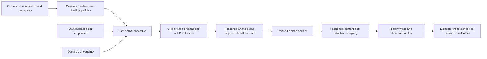

# Pacifica Timeline Lab product vision

**Strategic sketchpad and policy search · 25 October 2026 · Revision 0.7**

Timeline Lab is a fast strategic wargame for developing the Pacifica plot. The author changes a decision, sees generated histories, inspects consequential choices and retains useful ideas with their assumptions. The same model searches for strong Pacifica strategies and for plausible routes to declared narrative conditions, while other actors respond on their own terms. Strategic success and the author's interest in a story are separate.

The six authored timelines are financial regression references and comparator strategies. They do not define the available futures, and the author never has to write the outcome of a path in advance.

## Changes in revision 0.7

| Design choice | Treatment |
|---|---|
| Attributable agency | Decision contexts bind people, institutions, authority, resources and the actual choice procedure; recorded reasons identify inputs used. |
| State and information | Registered predicates, immutable revisions, target/valid/belief times and delivered snapshots prevent old reports rewriting current truth. |
| Open discovery | R0 surfaces causal story candidates before strategic pruning without a predefined ending; spontaneous bookmarks remain independent. |
| Search meaning | R1 distinguishes a possible generated history, a reliable policy and a minimum premise change, with explicit temporal/search statuses. |
| Conduct | Actor/action-family bindings separate strict lawful execution, supported apparent authority and intentional breaches. |
| Dramatic explanation | Deterministic views expose goals, conflicts, choices, sacrifices, consequences and unresolved tensions with evidence. |
| Author evidence | Prepared, open-ended and held-out writing tasks are compared with notes/manual work; useful new ideas must survive assumption disclosure. |
| Accounting | MetricSample differs from actor Observation; root worlds, evaluations, branches and retries have distinct population identities. |
| Delivery | A small M0 semantic prototype precedes optimized interface commitments. The 76 stable requirements and 12 phase gates remain synchronized. |

## Confirmed product choices

| Choice | Status |
|---|---|
| Search generated paths rather than only compare six descriptions | Required by the author |
| Compare trade-offs among several success variables | Selected by the author |
| Control Pacifica; other actors make their own decisions | Selected by the author |
| Calculate independently of Excel | Required by the author |
| Research professional wargame measures before adopting a scorecard | Required by the author |
| Fast, easy exploration of plot ideas | Requested by the author |
| Explicit ontology and review recommendations for plot discovery | Incorporated at the author's request; particular characters, rules and narrative conditions remain to select |
| Two loops, declared fidelity levels, diverse strategy archives, response/stress assessment, storyline layer, Git/columnar storage | Design recommendations incorporating the review; parameter and scope choices remain proposed |
| Exact success measures, thresholds, risk preferences and pilot boundaries | Still to define |

This is a strategic simulation and plot-exploration product. Its author can value a history that is strategically inferior. Storage, optimization and presentation serve the decisions, explanations and writing workflow.

## Two loops on one model

Both loops separate actor objectives from author interest. R0 surfaces causal alternatives without a requested ending, supports filters and spontaneous bookmarks, and exposes decision reasons. R1 adds explicit existential-history, policy-reliability and minimum-premise-change search. An author query never supplies future information to an actor.

### The sketch loop

The author opens a pinned world and changes a supported Pacifica lever: the terms of a financing offer, the timing of a funded readiness programme, or a cash threshold below which new commitments are postponed. Outcome fans stream in against a reference sketch with matched external worlds. The provisional targets are 1,000 paths visible within one second at p95 and 10,000 within ten seconds, subject to the M0 benchmark.

R0 implements one agreed financing/commitment dilemma, its indispensable institutions and selected character beliefs/intentions. Counterparties can refuse or counteroffer. Monthly cash timing, contested authority and the consequences of one supported breach case are explicit. The slice demonstrates a consequential choice and understandable alternatives; it cannot establish global diplomatic or military optimality.

Selecting an adverse or representative path opens its recorded decisions, responses and events, with an offline deterministic summary. An explicit save creates a named version; temporary slider edits do not require Git branches or commits. Optional LLM narration follows in R2, after the author workflow is established.

Sketching evaluates an author's policy idea. Selecting an interesting history preserves it even if it is dominated. A branch can change a Pacifica decision, a declared premise or an explicitly imposed event; ordinary policy runs never prescribe another actor's acceptance.

### The campaign loop

The author defines objectives, constraints and behavior descriptors, then explores strategies through two complementary views:

- **The trade-off frontier:** the best-found nondominated policies across selected distributional objectives.
- **The strategy map:** bounded nondominated policy sets within behavior cells, exposing different ways to pursue Pacifica's goals without a hidden single quality score.

Descriptor coordinates summarize a policy across a registered world design, with never/undefined cases and assignment uncertainty. A lucky realized history cannot alone determine a policy's type.

Finalists receive additional sampling when ranks or tails are uncertain. They face other actors' best or near-best responses to those actors' own goals, and a separately labelled hostile stress search under stated plausibility and acceptable-own-outcome bounds. At least one Pacifica revision round precedes a fresh final assessment.

Both loops share the semantic ontology, mechanism definitions, action catalog and actor models. A sketch can seed a campaign; a finalist or author bookmark can return to a reconstructed decision point for variation. An author archive remains separate from the strategy map.

## What the finished tool should let the author do

Start from a pinned world state. Choose the decision horizon, Pacifica's policy instruments, the objectives to compare and the constraints that must hold. Define uncertain external conditions and the plausible behavior of other actors.

Sketch an idea in seconds and see how often it works, how it fails and what the typical histories look like. Search for strong and diverse strategies when the idea deserves rigour, with evidence gates appropriate to the supported question. Inspect a policy's conditional rules, typical and adverse trajectories, failed cases, binding resource constraints and the decisions that matter most. Restrict the acceptable outcome range, inspect why an ally refused an offer, replay a crisis or change an assumption and search again.

A policy might delay a commitment when cash or transport falls below a threshold, then reconsider after recovery. The author does not prescribe every event that follows.

The saved result is a policy plus its assessed distribution of outcomes. A particular history can be checked through the detailed ledger. If detailed timing changes what was feasible, re-evaluate the policy as a new linked history before treating the strategy as financially supported. Exported storylines preserve decisions, chance events, conditions and assessment status.

## From histories to storylines

The author can start with a decision and ask for varied consequences without knowing an ending. R0 examines each generated history or reconstructible compact trace before strategic pruning and keeps bounded representatives of different causal structures. A failed rescue, an institutional compromise and a successful rescue that frustrates a personal promise may be distinct possibilities; these examples establish no canon. Different cash totals alone do not make different plots.

Each candidate shows a focal actor, goal, obstacle or conflicting commitment, consequential choice, sacrifice, supported consequence and unresolved tension. The template cites decision and event records, exposes assumptions and leaves unsupported elements blank or explicitly unknown. A useful idea can be bookmarked spontaneously, with no prior query, and retained independently of strategic rank or later clustering.

A DecisionContext identifies who acts, on whose behalf, under which authority, using whose resources and which information. The pinned procedure states how selected personal and institutional goals influence the choice. Its DecisionRecord records actual inputs and relevant rejected alternatives; retrospectively attaching a goal does not explain a motive. Failed plans and actor-perceived success remain distinct from actual outcomes. These principles draw on [Sabre](https://ojs.aaai.org/index.php/AIIDE/article/view/18896) and [CPOCL](https://ojs.aaai.org/index.php/AIIDE/article/view/12428), without adopting their centralized actor control.

R1 offers three explicit questions: find a supported generated route; find a policy that produces a condition reliably across declared worlds; or find a bounded minimum premise change that permits a route. A rare witness need not be a good policy. Each mode declares variables, intervention scope, evidence, sampling, temporal conditions and budget. Search exhaustion does not prove impossibility, and a partial history cannot prove that no crisis occurs after it stops. Imposed outcomes remain conditional consequence experiments.

R1 statistical history types retain empirical shares and actual representatives, while narrative candidates organize causal conflicts and choices. Rare/terminal paths remain accessible. Root-world, evaluation, branch and selected-population counts are explicit; targeted shares are not unconditional probabilities. Freeze selected policies and assess fresh unconditioned worlds for ordinary distributional claims.

Optional R2 narration renders supported typed claims, inserts saved numbers and records provider/prompt/model/check versions. Its motives require executed decision reasons and its causal claims require mechanism/intervention support. Unsupported prose remains author interpretation. The offline structured timeline and deterministic dramatic summaries are complete in R0/R1; narration cannot change calculations or approve canon.

## Explicit semantics and author control

The [ontology](ontology.md) distinguishes persons, offices, institutions and factions; underlying facts, source assertions, delivered observations and beliefs; goals, plans, promises and legal obligations; and attempts, adjudication and realized events. Dated qualified relations express consent, jurisdiction, ownership and practical access without collapsing them into a country-level Boolean.

Policies see only permitted information, including action menus and previews. An attempt that appears feasible can fail when actual resources or counterpart responses resolve. Simultaneous commitments reserve and settle scarce resources through registered rules rather than incidental module order.

Conduct profiles bind named actors/action families. lawful means strict lawful execution for that binding; apparent_authority separately models supported acts mistakenly believed authorized; breach_exploration covers registered intentional violations. Pacifica can remain lawful while a counterparty independently breaches. Actual legality, perceived authority and delayed discovery differ; later remedy preserves prior breach intervals and unsupported variants remain disabled.

At a recorded decision point, reconstruct the full relevant world and actor state. Distinguish changing Pacifica's decision, changing a dated premise and imposing a conditional event. Preserve established history and show the first consequential divergence; earlier causal changes require an earlier fork.

Registered predicates and immutable revisions distinguish a claim's target period from receipt and belief time. Delivered payloads remain fixed, and numerical MetricSample results do not enter actor information without an explicit observation channel. Branches retain controller state and identify author overrides without inventing motives.

Mechanisms have runtime applicability envelopes. Crossing a boundary withholds affected claims by default. An explicit registered provisional continuation creates a linked conditional experiment useful for writing, with dependent uncertainties preserved and stronger rankings unavailable.

## What professional wargames actually track

Professional games are designed around an analytical question; there is no universal victory score. The U.S. Naval War College's adjudication forum describes purpose-specific methods and a spectrum of human and simulation adjudication. Its STORM example includes multi-sided stochastic operations with logistics, maintenance, intelligence and weather. These are methodological precedents, not a claim that Pacifica has their validation or fidelity. [Naval War College proceedings, pp. 14–15 and 34](https://usnwc.edu/_images/portals/0/News-and-Events/15April2022-Proceedings5d2a.pdf).

The distinction between the world state, activity measures and desired outcomes is essential:

| Domain | What established approaches represent | Proposed Pacifica measures |
|---|---|---|
| Forces and readiness | Units, capability, location, mission, losses and availability | Usable forces by theatre; mobilisation delay; force-days that can actually be sustained |
| Logistics and geography | Supplies, consumption, transport networks, resupply and maintenance | Fuel/ammunition buffers; shipping and rail throughput; route disruption duration; recovery time |
| Information and time | Perceived opposing forces, reports, movement and timing | Observation delay; decision latency; uncertainty about readiness or intentions |
| Political and human factors | Cohesion, leadership, support, willingness to continue and audience behavior | Documented stability states; treaty compliance; willingness to honour commitments or negotiate |
| Economics and public finance | Required supporting model for Pacifica's long horizon | Real income/consumption, productive capacity, debt service, cash buffers and fiscal failure |
| Strategic relationships | Actor objectives, changing alignment, consent and responses | Durable legal access, voluntary partner cooperation, autonomy and exposure to failed commitments |
| Human consequences | Losses and the political consequences of sacrifice | Military/civilian deaths, displacement, disruption and recovery burdens |

The first three rows draw on JTLS-GO's units, reports and logistics model: its documentation includes consumption, transport, system repair and casualty evacuation. This supports tracking operational feasibility, rather than treating an inventory count as usable power. The specific Pacifica metrics are proposed adaptations to the historical setting. [JTLS-GO Executive Overview, sections 3.4 and 3.7](https://www.rolands.com/jtls/j_vdds/executive_overview.pdf).

Political assessments need different treatment. RAND's will-to-fight research considers leadership, cohesion, popular support, alliances, stakes and capabilities, while explicitly rejecting a precise universal formula for human will. The MOD influence handbook includes cases assessed through observed behavior and qualitative judgments. Pacifica therefore needs explicit behavioral assumptions and anchored qualitative states where evidence does not support numeric precision. [RAND will-to-fight research](https://www.rand.org/pubs/research_briefs/RB10040.html), [MOD Influence Wargaming Handbook, chapters 3–4 and Annex A](https://assets.publishing.service.gov.uk/government/uploads/system/uploads/attachment_data/file/1164868/Influence_Wargaming_Handbook_web.pdf).

The long-horizon economic and institutional measures are our proposed extensions for Pacifica. Operational simulation documentation does not validate GDP equations or supply historical coefficients for nineteenth-century institutions.

## Proposed success-measure catalog

Track a broad set of state quantities, but select a manageable set of objectives for each search. Start by considering three to five competing objectives; keep other concerns as constraints or diagnostics. The following are candidates, not approved weights or numeric targets.

| Success family | Candidate outcome | Definition needed before use |
|---|---|---|
| Security and autonomy | Time retaining required sovereignty/access conditions; risk of failing a defined security commitment | Whose security, which territories/rights and what counts as failure |
| Prosperity | Cumulative real consumption or income per person; adverse-case prosperity | Population scope, price basis and whether GDP is only an available proxy |
| Fiscal resilience | Minimum cash coverage; peak debt-service burden; default incidence | Essential spending/revenue denominators, horizon and treatment of emergency finance |
| Sustainable capability | Ability to maintain a specified commitment for a stated duration | Theatre, mission, force readiness, supply demand and required duration |
| Political durability | Continuity of agreed institutions and accepted authority | Observable conditions or anchored states, succession rules and evidence for transitions |
| Partnership and access | Durable voluntary cooperation, treaty fulfilment and usable legal access | Named partners/rights, consent, obligations and failure conditions |
| Human cost and recovery | Cumulative deaths, displacement and disruption | Affected population, military/civilian distinction and recovery period |
| Partner resilience | Partner prosperity, solvency and institutional continuity | Partner-specific boundaries and independent interests, without adding their output to Pacifica GDP |

A measure's contract includes its units, beneficiary, direction, geography, observation/evidence type, time aggregation and aggregation across futures. An experiment can maximize typical prosperity, improve a lower-tail prosperity outcome, reduce upper-tail losses or improve joint target attainment.

For example, the fraction of runs that satisfy both a fiscal and security condition must be calculated jointly. Multiplying two marginal success rates would generally be wrong when those outcomes are dependent.

Inventory, spending and treaties signed are potential drivers or activity measures. They become objectives only if the author deliberately values them in their own right. Coalition agreement does not automatically equal durable support, and territory controlled does not automatically equal lawful sovereignty.

Measures also serve a second purpose in this revision: **behaviour descriptors** for the strategy map. These describe how a policy acts, for example when it first commits to an alliance, what share of spending goes to readiness, or how heavily it borrows, rather than how well it scores.

Existing GDP/Treasury series provide part of the economic foundation. Readiness, logistics, political behavior, partner responses and human consequences require additional definitions, data and model checks. Unsupported objectives must be disabled or explicitly conditional rather than filled with invented scores.

## How paths are generated

At each decision point, actors receive dated observations, update selected beliefs/plans and choose attempts from their perceived options. Adjudication resolves actual authority, resources, independent responses and uncertain effects. The world advances according to the registered economic, financial, logistical and political mechanisms.

A compact formulation is:

`next_state = transition(current_state, Pacifica_action, other_actor_actions, uncertain_events, model_parameters)`

The fast engine evaluates many worlds through batched operations or profiled compiled kernels. Explicit state bindings and draw addresses preserve each world's rules and isolation; the implementation does not rely on one Python object graph per world.

Pacifica's policy chooses its action from the information available at that time. It cannot inspect future shocks or hidden opponent information. Other actors have their own objectives, observations, resource limits and response policies; independent agency does not imply uncorrelated behavior.

The action catalog separates perceived eligibility from actual preconditions and specifies authority, costs, delays, reservations, consequences and disclosure rules. Pacifica can make an offer, invest, borrow, change a commitment or alter a supported policy. It cannot directly choose another state's acceptance, a constitutional outcome or a favourable crisis resolution.

Events may be exogenous, such as an external disturbance, or endogenous to state and decisions. The distinction must be explicit. The catalog and transition rules generate the branches, rather than selecting among prewritten story endings.

## Monte Carlo, optimization and diversity have separate jobs

Monte Carlo evaluates a policy under a declared world design; strategic optimization proposes policies; narrative selection surfaces causal variety. Random seeds and counterparty agreement are never Pacifica policy variables. A separately declared story sampler may target uncertain conditions and must retain its selection/weight contract; its selected shares do not establish ordinary probabilities.

**Trade-off frontier.** Estimate policies for which no evaluated alternative improves one selected objective without worsening another. This is a best-found set within the model, policy family and budget. NSGA-II/III are candidates to benchmark, not a rule that fixes the algorithm solely by objective count. [pymoo](https://pymoo.org/algorithms/moo/nsga2.html).

**Strategy map.** Quality-diversity methods such as MAP-Elites motivate the map, but an ordinary scalar elite does not settle Pacifica's multiobjective choice. Keep a bounded nondominated set per cell with explicit deterministic diversity-pruning. Test against exhaustive small cases, including capacity limits and noisy descriptor assignment. Archive coverage is not robustness. [MAP-Elites](https://arxiv.org/abs/1504.04909), [pyribs archive behavior](https://docs.pyribs.org/en/latest/api/ribs.archives.GridArchive.html).

**Response and stress.** Ordinary response models pursue each actor's own stated preferences and may cooperate. Hostile stress searches state which Pacifica outcome is stressed and restrict responses by resources, information, plausibility and the actor's own acceptable outcomes. A diminished advantage is labelled response/stress sensitivity. An exploit finding requires a reproducible violation or identified unrealistic mechanism. One iteration of response search does not establish equilibrium or low exploitability; PSRO is a methodological reference, not a guarantee. [PSRO](https://arxiv.org/html/1711.00832v2).

When probability distributions lack support, report robustness, regret and failure conditions across plausible worlds. Equally tested scenario fractions are not historical probabilities. [RAND robust decision making](https://www.rand.org/pubs/tools/TL320/tool/robust-decision-making.html), [EMA directed search](https://emaworkbench.readthedocs.io/en/latest/indepth_tutorial/directed-search.html).

## Conditions for credible results

**Semantic and creative evidence.** R0 tests identity, claims/beliefs, observation-safe eligibility, competing reservations, actor-scoped conduct treatment, decision reconstruction and applicability propagation. The author reviews predeclared writing tasks for causal variety, meaningful agency, branch clarity and retained useful ideas. Throughput and automated prose scores cannot substitute for that judgment.

**Credibility starts in R0.** Each displayed quantity identifies ownership, geography, units, source/assumption IDs, producing module, coverage and fidelity. Unsupported outcomes remain unavailable or explicitly named proxies. Monthly or finer timing is required wherever it changes liquidity or an action's feasibility.

**Fit and intervention checks differ.** Pin baseline calibration bands, then test accepted/refused/counteroffered financing, changed terms and dates, failed rollover and an interim cash shortage against independent reference calculations. Baseline agreement cannot establish correct off-baseline behavior. Full six-case regression is a later R2 obligation.

**Fidelity is explicit.** Both engines use shared mechanism definitions with versioned aggregation/projection rules. Small reference accounts support the first slice; the detailed ledger later provides full instrument schedules. Forensic mode checks a recorded path and identifies its first infeasible commitment. Policy re-evaluation runs the same conditional policy with detailed resources and observations; later decisions and responses may change, producing a new linked history. A changed feasibility or loss state is material even inside a broad calibration band. Numerical tolerances, baseline fit and off-baseline error envelopes are separate claims.

**Assessment separates development from evidence.** Random variation, uncertain parameters and alternative actor/structural models remain distinct, with correlations and persistence. Roughly 100 worlds per candidate is an initial screening budget; close ranks and sparse tails need additional samples under registered stopping rules. Freeze candidates and response assumptions before final assessment. Reused assessment feedback becomes development data and requires fresh final worlds.

**Reproducibility needs more than a seed.** Draw addresses include world design, world, time, stream and entity/event/ordinal where needed; matched comparisons share exogenous addresses without shifting them when a branch changes. Pin environment and dependency builds and test batch/worker independence. Cross-environment guarantees have explicit tolerances and logical-decision rules.

**Tests must expose impossible gains.** Use small exhaustive search/archive cases and simple/random policies under equal budgets. Check free resources, instant mobilisation, automatic consent, hidden future information and debt or harm deferred beyond the horizon. More rollouts cannot repair an unsupported behavioral model.

**Failures remain visible.** Defeat, default and terminal harm remain scored outcomes. Computational errors stay separately accounted and block unsupported rankings; they do not become invented utility values. Stored manifests preserve complete, partial and failed statuses.

The six authored cases test financial equivalence only in labelled fixture replay. Authored future overrides cannot force actor outcomes in discovery. Broader credibility requires evidence for the mechanisms and conditions actually claimed.

## What the dashboard should show

| Workspace | Main result |
|---|---|
| Sketch | Levers and assumptions on one side; outcome fans streaming in against the previous sketch with matched shocks |
| Define the problem | Objectives, constraints, behaviour descriptors, controlled actor, action families, initial state and horizon |
| Review the model | Evidence, mechanism coverage, calibration bands, uncertainty and other actors' response assumptions |
| Run a search | Evaluation budget, progress, unique policy counts, completed futures and errors |
| Compare trade-offs | Estimated Pareto frontier, distribution plots, downside and joint target attainment |
| Strategy map | Distinct behavior cells, within-cell Pareto representatives, descriptor uncertainty and assessment status |
| Explain a policy | Conditional decisions, bottlenecks, own-interest responses, separate stress results and failure conditions |
| Story exploration | Open causal candidates before strategic pruning, explicit search modes, supported dramatic views and spontaneous bookmarks |
| Storylines | History types with stated denominators, distinguishing conditions and representative paths |
| Replay and branch | Complete decision state; separate decision/premise/imposed-event modes; structured explanation, later optional narration and detailed reassessment |
| Export | Reproducible strategy/evaluation package and an optional draft storyline |

The author should be able to see why a policy looks attractive, the assumptions that make it work, the circumstances in which it fails and the kinds of story it tends to produce.

## Speed and scale

Speed is a product feature. M0 must measure a realistic bounded question before targets become commitments.

| Workload | Provisional target |
|---|---|
| Sketch first view | 1,000 paths displayed within 1 second at p95 after an edit |
| Refined sketch | 10,000 paths within 10 seconds |
| Base campaign | 1,000 candidate policies × 100 screening worlds within 5 minutes on 8 declared CPU workers and 16 GB RAM |
| Compact queries | Summaries of 100,000 paths within 1 second |
| Detailed R2 assessment | One selected 1904–1932 path checked within 10 seconds; policy re-evaluation measured separately |

The spike includes negotiations, queues, material subannual timing, checks, logs, summaries, persistence and visible delivery. Record cold start/compilation separately from warm edit-to-visible latency. Fix hardware, actors, steps, fidelity, memory and included stages; explicitly revise a target if the supported model needs a different workload.

Additional sampling, response/stress searches, held-out assessment, history processing and narration have declared budgets and timings. They are not free work hidden behind the 100,000-evaluation target. Reused evaluations count once; the campaign records both base and total costs.

Batch result files outside simulation time steps. Retained manifests and a single catalog coordinator make local publication recoverable; an atomic file rename alone does not transact across files, Git and the query catalog.

## Scope of the first releases

| Release | What it delivers |
|---|---|
| R0 bounded dramatic sketch | One supported dilemma with attributable decisions, predicate/time semantics, native checks, actor-scoped conduct, settlement, complete branches, open causal candidates, spontaneous bookmarks and author evaluation |
| R1 strategy and plot discovery | Assessed strategic trade-offs and responses, history types, existential-history/policy-reliability/minimum-premise-change search, explicit populations and repeated held-out author review |
| R2 supporting tools and detailed fidelity | General catalog editing, useful structural generation, optional grounded LLM narration, forensic checks and policy re-evaluation, full instrument schedules, six-fixture parity, finance-skill integration and deep inspection |
| R3 expansion | Additional supported questions, regions, actors and mechanisms; semantic rebases; separately designed hosted/multi-user mode |

A shorter slice within 1904–1932 is permitted when its question, active ontology and limits are explicit. Broader discovery eventually combines finance, diplomacy and sustainable capability. The 1846–1932 fixtures remain an R2 regression obligation.

M0 selects the dramatic question and author evaluation protocol, specifies the semantic/adjudication contracts and applicability envelopes, checks independent financial cases and measures realistic speed. M1/R0 demonstrates causal alternatives, consequential agency, a selected belief-driven plan change, a branch and a retained interesting history before broad tooling or search-scale commitments.

M0 first proves a small semantic prototype before fixing optimized engine interfaces. The author protocol includes prepared questions, open exploration without a target, a supported question withheld from tuning and a notes/manual-workflow comparison. Record previously unconsidered causal ideas, usefulness after assumption disclosure, time, explanation gaps and repair. A revealed task used for tuning loses held-out status. Author judgment controls acceptance; a failed gate prompts a design or scope revision.

R1 demonstrates at least 1,000 candidate policies and 100,000 generated paths under the declared benchmark or an explicitly revised scope, plus a repeated author review and bounded narrative-condition search. Strategic assessment and targeted story selection retain separate denominators and claims.

The [objective sheet](objectives-and-constraints.md), [action and actor catalog](action-and-actor-catalog.md), [ontology](ontology.md) and [structured draft catalog](draft-model-catalog.json) supply definitions to narrow for the first question.

See [requirements.md](requirements.md), [backlog.json](backlog.json) and [model-architecture.md](model-architecture.md). Their revision 0.7 contracts and release gates are synchronized.
