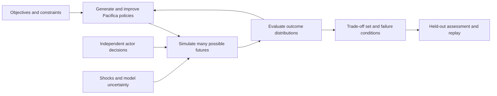

# Pacifica Timeline Lab product vision

**Strategic simulation and policy search · 25 October 2026 · Revision 0.3**

Timeline Lab should discover promising Pacifica strategies across thousands of generated histories. The author defines the starting world, available decisions, success measures and constraints. The system searches for adaptive policies, simulates independent actors and uncertain events, and presents the resulting trade-offs, risks and decision sequences.

The six authored timelines are financial regression references and possible comparator strategies. They do not define the available futures or require the author to write the outcome of each path.

## Confirmed product choices

| Choice | Status |
|---|---|
| Search generated paths rather than only compare six descriptions | Required by the author |
| Compare trade-offs among several success variables | Selected by the author |
| Control Pacifica; other actors make their own decisions | Selected by the author |
| Calculate independently of Excel | Required by the author |
| Research professional wargame measures before adopting a scorecard | Required by the author |
| Exact success measures, thresholds, risk preferences and pilot boundaries | Still to define |

This is a strategic simulation and optimization product. The database and dashboard support that purpose; their detailed design follows the model's decisions, dynamics and evidence needs.

## What the finished tool should let the author do

Start from a pinned world state. Choose the decision horizon, Pacifica's available policy instruments, the objectives to compare and the constraints that must hold. Define uncertain external conditions and the possible behavior of other actors.

Press **Explore strategies**. The system generates policy candidates and tests them across many futures. It returns a set of strong trade-offs: one policy may deliver greater prosperity, another better protection against fiscal distress, another fewer casualties or more reliable political partnerships.

Selecting a policy shows its conditional rules, typical and adverse trajectories, failed cases, binding resource constraints and the decisions that matter most. The author can restrict the acceptable outcome range, inspect why an ally refused an offer, replay a crisis or change an assumption and search again.

The saved result is a policy plus its assessed distribution of outcomes. A particular realized timeline can then be exported as a draft storyline, with its decisions, chance events and conditions preserved.

A policy might delay a commitment when cash or transport falls below a threshold, then reconsider after recovery. The author does not have to prescribe every event that follows.

## What professional wargames actually track

Professional games are designed around an analytical question; there is no universal victory score. The U.S. Naval War College's adjudication forum describes purpose-specific methods and a spectrum of human and simulation adjudication. Its STORM example includes multi-sided stochastic operations with logistics, maintenance, intelligence and weather. These are methodological precedents, not a claim that Pacifica has their validation or fidelity. [Naval War College proceedings, pp. 14–15 and 34](https://usnwc.edu/_images/portals/0/News-and-Events/15April2022-Proceedings5d2a.pdf).

The distinction between the world state, activity measures and desired outcomes is essential:

| Domain | What established approaches represent | Proposed Pacifica measures |
|---|---|---|
| Forces and readiness | Units, capability, location, mission, losses and availability | Usable forces by theatre; mobilisation delay; force-days that can actually be sustained |
| Logistics and geography | Supplies, consumption, transport networks, resupply and maintenance | Fuel/ammunition buffers; shipping and rail throughput; route disruption duration; recovery time |
| Information and time | Perceived opposing forces, reports, movement and timing | Observation delay; decision latency; uncertainty about readiness or intentions |
| Political and human factors | Cohesion, leadership, support, willingness to continue and audience behavior | Documented stability states; treaty compliance; willingness to honour commitments or negotiate |
| Economics and public finance | Required supporting model for Pacifica's long horizon | Real income/consumption, productive capacity, debt service, cash buffers and fiscal failure |
| Strategic relationships | Actor objectives, changing alignment, consent and responses | Durable legal access, voluntary partner cooperation, autonomy and exposure to failed commitments |
| Human consequences | Losses and the political consequences of sacrifice | Military/civilian deaths, displacement, disruption and recovery burdens |

The first three rows draw on JTLS-GO's units, reports and logistics model: its documentation includes consumption, transport, system repair and casualty evacuation. This supports tracking operational feasibility, rather than treating an inventory count as usable power. The specific Pacifica metrics are proposed adaptations to the historical setting. [JTLS-GO Executive Overview, sections 3.4 and 3.7](https://www.rolands.com/jtls/j_vdds/executive_overview.pdf).

Political assessments need different treatment. RAND's will-to-fight research considers leadership, cohesion, popular support, alliances, stakes and capabilities, while explicitly rejecting a precise universal formula for human will. The MOD influence handbook includes cases assessed through observed behavior and qualitative judgments. Pacifica therefore needs explicit behavioral assumptions and anchored qualitative states where evidence does not support numeric precision. [RAND will-to-fight research](https://www.rand.org/pubs/research_briefs/RB10040.html), [MOD Influence Wargaming Handbook, chapters 3–4 and Annex A](https://assets.publishing.service.gov.uk/government/uploads/system/uploads/attachment_data/file/1164868/Influence_Wargaming_Handbook_web.pdf).

The long-horizon economic and institutional measures are our proposed extensions for Pacifica. Operational simulation documentation does not validate GDP equations or supply historical coefficients for nineteenth-century institutions.

## Proposed success-measure catalog

Track a broad set of state quantities, but select a manageable set of objectives for each search. Start by considering three to five competing objectives; keep other concerns as constraints or diagnostics. The following are candidates, not approved weights or numeric targets.

| Success family | Candidate outcome | Definition needed before use |
|---|---|---|
| Security and autonomy | Time retaining required sovereignty/access conditions; risk of failing a defined security commitment | Whose security, which territories/rights and what counts as failure |
| Prosperity | Cumulative real consumption or income per person; adverse-case prosperity | Population scope, price basis and whether GDP is only an available proxy |
| Fiscal resilience | Minimum cash coverage; peak debt-service burden; default incidence | Essential spending/revenue denominators, horizon and treatment of emergency finance |
| Sustainable capability | Ability to maintain a specified commitment for a stated duration | Theatre, mission, force readiness, supply demand and required duration |
| Political durability | Continuity of agreed institutions and accepted authority | Observable conditions or anchored states, succession rules and evidence for transitions |
| Partnership and access | Durable voluntary cooperation, treaty fulfilment and usable legal access | Named partners/rights, consent, obligations and failure conditions |
| Human cost and recovery | Cumulative deaths, displacement and disruption | Affected population, military/civilian distinction and recovery period |
| Partner resilience | Partner prosperity, solvency and institutional continuity | Partner-specific boundaries and independent interests, without adding their output to Pacifica GDP |

A measure's contract includes its units, beneficiary, direction, geography, observation/evidence type, time aggregation and aggregation across futures. An experiment can maximize typical prosperity, improve a lower-tail prosperity outcome, reduce upper-tail losses or improve joint target attainment.

For example, the fraction of runs that satisfy both a fiscal and security condition must be calculated jointly. Multiplying two marginal success rates would generally be wrong when those outcomes are dependent.

Inventory, spending and treaties signed are potential drivers or activity measures. They become objectives only if the author deliberately values them in their own right. Coalition agreement does not automatically equal durable support, and territory controlled does not automatically equal lawful sovereignty.

Existing GDP/Treasury series provide part of the economic foundation. Readiness, logistics, political behavior, partner responses and human consequences require additional definitions, data and model checks. Unsupported objectives must be disabled or explicitly conditional rather than filled with invented scores.

## How paths are generated

At each decision point, actors observe part of the current state, choose feasible actions and encounter uncertain outcomes. The world advances according to the registered economic, financial, logistical and political mechanisms.

A compact formulation is:

`next_state = transition(current_state, Pacifica_action, other_actor_actions, uncertain_events, model_parameters)`

Pacifica's policy chooses its action from the information available at that time. It cannot inspect future shocks or hidden opponent information. Other actors have their own objectives, observations, resource limits and response policies; independent agency does not imply uncorrelated behavior.

The action catalog specifies preconditions, authority, costs, delays and effects. Pacifica can make an offer, invest, borrow, change a commitment or alter a supported policy. It cannot directly choose another state's acceptance, a constitutional outcome or a favourable crisis resolution.

Events may be exogenous, such as an external disturbance, or endogenous to state and decisions. The distinction must be explicit. The catalog and transition rules generate the branches, rather than selecting among prewritten story endings.

## Monte Carlo and optimization have separate jobs

Monte Carlo samples outcomes under a specified policy and uncertainty model. Optimization searches over policies. The search must not select random seeds or assume cooperative opponents to obtain the most fortunate path.

Use multiobjective search to estimate a Pareto frontier: policies for which none of the evaluated alternatives improves at least one selected objective without worsening any other. This is a best-found set within the chosen model and search budget, not a proven globally optimal history.

Start with interpretable parameterized decision rules and bounded action sequences. Evolutionary multiobjective search is a candidate for mixed choices, timing and thresholds; pymoo documents relevant algorithms and mixed-variable support. The EMA Workbench provides useful experiment, directed-search and robustness patterns. These packages are implementation candidates, not complete wargame engines. [pymoo NSGA-II](https://pymoo.org/algorithms/moo/nsga2.html), [mixed-variable support](https://pymoo.org/customization/mixed.html), [EMA directed search](https://emaworkbench.readthedocs.io/en/latest/indepth_tutorial/directed-search.html).

Where uncertainty cannot justify probabilities, evaluate strategies across plausible worlds and report robustness, regret and failure conditions. RAND's robust decision-making approach explicitly examines strategies across many futures and uses vulnerability/trade-off analysis to improve them. A fraction of equally tested scenarios is not automatically a real-world probability. [RAND robust decision making](https://www.rand.org/pubs/tools/TL320/tool/robust-decision-making.html).

## Conditions for credible results

Separate random variation, uncertain parameter values and alternative structural models. Preserve relevant correlations and time persistence. Political uncertainty should not become a precise probability merely because the engine accepts a number.

Search on one set of worlds; assess finalists on fresh held-out worlds and alternative opponent models. Report outcome distributions, downside, sample sufficiency and rank changes across assumptions. Once a held-out set is used to redesign a policy, it becomes development evidence and a new final assessment set is needed.

Keep exogenous draws matched when comparisons permit it, using documented random-stream allocation. Endogenous crises and actor decisions must still be allowed to differ. Worker scheduling must not change the result.

Test the optimizer on small problems whose frontier can be enumerated, and compare it with simple policies and random search under equal budgets. Test the world model for impossible free resources, instantaneous mobilisation, automatic treaty acceptance, future-information leakage and benefits created by deferring obligations beyond the horizon.

The six existing cases test financial consistency in a labelled fixture-replay mode that may prescribe authored events; strategy discovery cannot use those overrides to force other actors' outcomes. Strategic credibility also needs independent cases, evidence for actor responses, expert review and sensitivity to alternative mechanisms. More rollouts reduce sampling noise; they do not repair a wrong behavioral model.

Record bankruptcies, defeats and other terminal losses in the outcome population. Computational failures require a separate status and resolution; neither kind of failure may disappear from the assessment denominator.

## What the dashboard should show

| Workspace | Main result |
|---|---|
| Define the problem | Objectives, constraints, controlled actor, action families, initial state and horizon |
| Review the model | Evidence, mechanism coverage, uncertainty and other actors' response assumptions |
| Run a search | Evaluation budget, progress, unique policy counts, completed futures and errors |
| Compare trade-offs | Estimated Pareto frontier, distribution plots, downside and joint target attainment |
| Explain a policy | Conditional decision rules, bottlenecks, opponent responses and failure conditions |
| Replay and branch | A selected successful, typical or adverse history with its observations and choices |
| Export | Reproducible strategy/evaluation package and an optional draft storyline |

The author should be able to see why a policy looks attractive, the assumptions that make it work and the circumstances in which it fails.

## Scale and the first convincing demonstration

The first usable release must contain the discovery loop, even if its geography, dates and action families are restricted. A bounded 1904–1932 decision window is a proposal; the 1846–1932 financial fixtures remain available separately.

The proposed pilot combines financing/investment, diplomatic commitments and strategic readiness/sustainment, with Pacifica plus independently responding actors. Exact actors, mechanisms and success criteria need agreement before detailed schema work.

A release demonstration should generate at least 1,000 distinct policy candidates and 100,000 complete paths from the starting state, without authored future narratives. It must include adaptive decisions, independent refusals/counteroffers, assessed trade-offs, held-out evaluation and replayable failures.

One thousand policies tested against 100 futures already require 100,000 rollouts, plus separately budgeted finalist assessment. The old two-minute reference-case budget is therefore unsuitable. A proposed benchmark is 100,000 bounded-pilot trajectories within 30 minutes on eight documented CPU workers and 16 GB RAM. This is an unmeasured engineering target, not a performance claim or approved commitment. Profile a credible native kernel before fixing it.

Store search metadata, policies, inputs and compact evaluations in the versioned database. Batch larger numeric artifacts, and retain the seeds and inputs needed to reconstruct full traces. Columnar storage such as Parquet is a candidate for bulk trajectories; avoid a database write on every simulation step. [Apache Parquet overview](https://parquet.apache.org/docs/overview/).

Implementation order is: define success and agency; establish evidence and dynamics; verify the native world kernel; implement repeated evaluation and search; then build the exploration dashboard. The next design artifact is the agreed objective/constraint sheet and action/actor catalog, not a finalized database schema.

The [objective and constraint sheet](objectives-and-constraints.md) and [action and actor catalog](action-and-actor-catalog.md) supply the proposed model definitions for author review. Their [structured draft catalog](draft-model-catalog.json) carries stable IDs, provenance and coverage gates; it is not an executable engine.

See [requirements.md](requirements.md), [backlog.json](backlog.json) and [model-architecture.md](model-architecture.md) for the corresponding requirements and provisional architecture.
