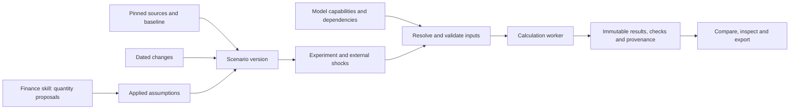

# Pacifica Timeline Lab requirements

**Draft for review · 25 October 2026 · Requirements version 0.1**

Build Timeline Lab around immutable timeline versions, dated changes and a reproducible calculation engine. The dashboard should let the author ask what changes when a policy, financing arrangement or event changes, inspect the assumptions behind the answer, and save the experiment.

The recommended first release imports the six existing cases and lets the author fork, edit and rerun a bounded set of financial changes. A comparison viewer is the first internal milestone. The broader world model grows through modules with explicit inputs, dependencies and limits.

These are proposed requirements and technology choices, not an approved implementation plan. The working assumptions are one author, private local use and a first release focused on financial scenario editing. First-release priority remains an open product decision. The current task creates a specification; it does not implement the application or approve a storyline.

## 1. Product purpose and users

The primary user is the Pacifica author, who needs to:

- Compare the baseline master storyline, a shared-change control and CR-032A–D on common definitions.
- Change a supported assumption or dated event without copying an entire workbook.
- See GDP, tax capacity, Treasury balances, debt, cash, reserves, claims and funding gaps evolve over time.
- Understand which costs, rights, receipts and obligations exist because of a particular timeline.
- Identify a missing estimate or unresolved continuation before interpreting an outcome.
- Save enough evidence to reproduce a comparison and review it later.

The model maintainer defines modules and checks; the finance skill proposes quantities and derivations. These are workflow roles, not a requirement for a multi-user permissions system in the first release.

“A/B testing” here means **counterfactual simulation**. The alternatives are modelled histories, not randomized observations. A difference between two runs is not statistical evidence that a policy caused the difference in the real world.

Success means the author can fork a case, make a supported dated change, recalculate, inspect its consequences and export a reproducible comparison without editing worksheet coordinates. The model must also make its limits apparent when a question exceeds its coverage.

## 2. Evidence and current state

The baseline is pinned to repository main commit `cc6e017780970433ab63bc95d0e3749510b44d49`. The alternatives are pinned separately to `626ffbb0bd6486c19164f89104569d78321ebd55`. The proposal file `CR-032.md` supplies the case labelled A; B, C and D remain separate alternatives. See the [pinned proposal index](https://github.com/c-voelkle/pacifica/blob/626ffbb0bd6486c19164f89104569d78321ebd55/book-agent/revision/alternatives/CR-032/README.md).

The existing [Ledger reference](https://github.com/c-voelkle/pacifica/blob/cc6e017780970433ab63bc95d0e3749510b44d49/finance/Pacifica-Ledger.md) describes a CR-021 rev8 display snapshot. It supplies useful dashboard domains, but its numbers are not the current experiment baseline. Its live interface was not inspected for this specification.

Six local JSON bundles now contain 87 annual periods, 1846–1932, and 73 annual metrics. They total 25,473,049 bytes and contain 17 labelled run records with 14 distinct input hashes. Baseline, control and A each reuse their native input for the matched-downturn label; these are not additional independent calculations.

| Pilot case | First model divergence from baseline | Branch divergence from control | Run records |
|---|---:|---:|---:|
| Baseline master-storyline model | — | — | 2 |
| Shared-change control | 1904 | — | 2 |
| A: war and coalition victory | 1904 | 1918 | 2 |
| B: negotiated 1917 peace | 1904 | 1916 | 2 |
| C: prewar diplomacy, conditional C0 continuation | 1904 | 1907 | 2 |
| D: completed no-general-war proposal | 1904 | 1907 | 7 |

The dates above are financial-model divergence metadata, not assertions that every narrative consequence begins in that year. The control isolates the common changes before comparing the alternatives.

The pilot used native Excel full recalculation. Its baseline evidence includes a 48,940-cell reconciliation, and the exported checks cover accounting, dated divergence and financing constraints. These checks establish consistency with the pinned model; they do not establish historical truth. Alternative GDP paths still depend on declared MODEL assumptions.

The current adapter contains CR-specific logic. There is no implemented Timeline Lab importer, authoring interface or portable world engine. The [finance skill](https://github.com/c-voelkle/pacifica/blob/507c56b68621a3447e07e70338aa10d4a9e54a48/.agents/skills/pacifica-scenario-finance/SKILL.md) is separately proposed in [draft PR 7](https://github.com/c-voelkle/pacifica/pull/7).

[fixture-manifest.json](fixture-manifest.json) records exact file hashes, sizes, variants and selected 1932 values. The six result files and supporting adapter scripts are local project outputs and are **not included in this requirements commit**. Their exact bytes must be staged in versioned project storage before regression implementation begins.

## 3. Scope of the first release

The first usable release includes import, branching, supported editing, quantity-proposal import, recalculation, accounting and coverage checks, comparisons, bounded sensitivities, provenance inspection and export/reimport.

The proposed editable surface is deliberately finite:

| Capability | First-release behavior |
|---|---|
| Dated parameter override | Change a registered parameter with units, bounds and effective periods; expose the corresponding dependencies. |
| Spending programme | Set a cost schedule, payer, destination, funding source and any explicitly modelled capacity/output effects. |
| Loan facility | Set lender/borrower shares, dates, limit, draws, interest, maturity, repayment and loss rules; reconcile both sides. |
| Existing scenario event | Inspect all imported events; edit, shift or remove one only if the model declares support and covers its material dependencies. |
| New narrative event | Record the proposed change and its unresolved effects; obtain quantity estimates and module mappings before claiming a complete calculation. |

A new event family must be registered through the module contract. CR numbers identify source proposals and fixtures; they must not become the engine's general branching mechanism.

Removing a war, changing a regime or granting territorial protection is more than changing a GDP multiplier. Where the model lacks a consequence, it must identify the gap, preserve conditional outputs where meaningful and block unsupported claims of completeness.

First-release validation rejects ambiguous overlapping edits. Later scope includes explicit rebase/overlay conflict resolution and richer demographic, industrial, trade, military-logistics and institutional modules. Real-time collaboration, automatic canon integration, complete global national accounts, an arbitrary agent-based simulation and Monte Carlo probabilities are outside the first release. Longer horizons may be added, but the pilot ends in 1932 and must identify obligations remaining at that endpoint.

## 4. Domain model

Use stable identities and an immutable snapshot plus dated overlays. The event/dependency structure is a logical model; it does not require a graph database.

| Object | Meaning and required distinction |
|---|---|
| Source snapshot | Pinned narrative documents, workbook/data hashes and their authority status. A newer main does not replace an existing snapshot. |
| Entity and geography | Sovereign, Treasury, firm, syndicate, lender, borrower or territory, with ownership and jurisdiction valid over stated dates. |
| Event/change | A dated set, add, remove, shift or replace operation targeting a stable ID, with preconditions and declared effects. |
| Instrument/right | Loan, bond, grant, concession, guarantee or treaty entitlement with counterparties, effective dates, cash flows and termination rules. |
| Assumption/quantity proposal | A value or schedule, evidence class, source, derivation, bounds and explicit uncertainties. Unknown is distinct from zero. |
| Scenario | The named alternative, such as D, with its own authority and unresolved conditions. |
| Scenario version | An immutable parent reference, overlay and applied assumption set. A working draft becomes a new version when saved for a run. |
| Experiment | A declared question, reference/control, selected versions, shock policy, horizon and finite sensitivity matrix. |
| Run | Immutable resolved inputs, engine/model identities, execution record, results, checks and provenance. Identical calculations may be reused with explicit aliases. |
| Observation/check | A typed quantity for an entity and period, or an evaluated identity/constraint with its residual, tolerance and coverage. |

The finance skill proposes; the deterministic engine computes. A run must not ask a language model to invent a missing value midway through calculation. The author may apply a validated batch of MODEL assumptions without a separate approval prompt for every cell.

## 5. Financial and temporal semantics

Every metric must identify its entity, geographic boundary, currency/unit, nominal or real price basis, period, quantity kind (stock, flow, rate, ratio or index) and aggregation rule. Core Pacifica GDP, Japanese output, Russian output and network GDP remain separate. Real GDP uses the stated base year; nominal Treasury flows cannot be compared directly with real GDP without a declared conversion.

Account for spending, lending principal, repayments, interest, asset acquisition, losses and financing separately. Avoided expenditure is not automatically additional GDP. Private or foreign syndicated lending is not all Treasury property. A removed or expired concession must lose its associated rights and receipts unless another event independently creates them.

Annual summaries sum flows and take the stated endpoint for stocks; ratios are recomputed from compatible components. Monthly liquidity schedules remain available because annual totals can hide a cash shortage. Finer timing must not be implied where the model only supports annual dates.

Run checks must cover budget/cash reconciliation, debt roll-forward, claims, lender-borrower schedules, timing and each supported resource constraint. A balanced accounting identity can coexist with an unfunded programme. Unsupported capital, FX, personnel or transport limits must be labelled unmodelled.

Date-aware evaluation is mandatory. The pilot's 1923 earthquake-loan dependency and 1928 Union-capacity sensitivity are regression examples: a later assumption must not alter earlier periods without a declared anticipation effect. A same-period cycle requires an explicit solver and convergence criteria or a clear failure.

C's 1932 output relies on its named C0 peaceful commercial continuation. D's institutions must not fill C's unresolved branches. D's North American defence/debt targets cannot be certified using core Pacifica GDP; unavailable denominators produce unavailable checks, with proxy ratios separately labelled. Complete net external claims are also not yet supplied.

The interface must maintain separate states for narrative authority, evidence quality, job execution, accounting validation, funding feasibility and model coverage. A completed computation may describe an infeasible or conditional draft.

## 6. Dashboard and authoring workflow

Keep persistent selectors for scenario versions, reference, native/matched-shock mode, years and the selected year. Use a common metric/units definition across every view.

| View | Author's task |
|---|---|
| Compare | Plot up to six cases; inspect levels, absolute changes and percentage changes for GDP, revenue, expenditure, balance, debt, cash and reserves. |
| Timeline | Inspect dated differences, shared changes, divergence points, conditions and links to affected quantities. |
| Assumptions | Fork a version, edit supported fields, inspect a skill proposal, see an impact preview and submit a run. |
| Accounts | Follow spending, financing, debt and claims, including finer schedules and remaining obligations. |
| Checks | Inspect failed identities, funding gaps, unsupported dimensions and unresolved assumptions. |

Selecting a number opens an inspector with its definition, run identity, formula/module, inputs and sources. Workbook cell mappings belong in this technical inspector. Charts require equivalent tables; color alone must not distinguish cases or status.

The main journey is **open experiment → fork case → edit dated assumption → inspect affected quantities → run → compare → explain → export**. Editing makes old results visibly stale. Failed or cancelled jobs retain the last completed result under its original version; they cannot inherit a passing badge.

“Explain difference” first shows changed inputs and dependency paths. Additive budget decompositions must reconcile. A GDP delta involving several changes must not be presented as an additive causal waterfall unless a stated method, controlled reruns and interactions justify it.

Matched-shock experiments hold selected external shocks constant while recomputing endogenous effects. They must not force identical bank-rescue draws merely to make paths look comparable. Parameter ranges and named downside cases are judgemental scenarios, not confidence intervals.

## 7. Requirements and acceptance register

The normative individual statements, source links, dependencies and Given/When/Then criteria are in [backlog.json](backlog.json). All 36 requirements are proposed: 34 Must requirements for R1 and two Should requirements for R2. Their acceptance criteria describe future verification; none has been satisfied merely by writing this specification.

| Requirement | Capability | Proposed priority/release | Acceptance |
|---|---|---|---|
| TL-001 | Pin every experiment | Must / R1 | AC-001 |
| TL-002 | Import the six bundles | Must / R1 | AC-002 |
| TL-003 | Define quantities explicitly | Must / R1 | AC-003 |
| TL-004 | Separate approval from calculation | Must / R1 | AC-004 |
| TL-005 | Fork without changing history | Must / R1 | AC-005 |
| TL-006 | Use dated semantic changes | Must / R1 | AC-006 |
| TL-007 | Track dependencies | Must / R1 | AC-007 |
| TL-008 | Review rebases and conflicts | Should / R2 | AC-008 |
| TL-009 | Handle unresolved continuations | Must / R1 | AC-009 |
| TL-010 | Integrate the finance skill | Must / R1 | AC-010 |
| TL-011 | Make runs reproducible | Must / R1 | AC-011 |
| TL-012 | Respect time and detect cycles | Must / R1 | AC-012 |
| TL-013 | Control calculation jobs | Must / R1 | AC-013 |
| TL-014 | Show fresh results accurately | Must / R1 | AC-014 |
| TL-015 | Reconcile the accounts | Must / R1 | AC-015 |
| TL-016 | Expose resource constraints | Must / R1 | AC-016 |
| TL-017 | Preserve ownership and geography | Must / R1 | AC-017 |
| TL-018 | Aggregate time correctly | Must / R1 | AC-018 |
| TL-019 | Compare like with like | Must / R1 | AC-019 |
| TL-020 | Run bounded sensitivities | Must / R1 | AC-020 |
| TL-021 | Explain differences honestly | Must / R1 | AC-021 |
| TL-022 | Compare the main trajectories | Must / R1 | AC-022 |
| TL-023 | Inspect the timeline | Must / R1 | AC-023 |
| TL-024 | Edit supported quantities | Must / R1 | AC-024 |
| TL-025 | Trace any displayed number | Must / R1 | AC-025 |
| TL-026 | Export a reproducible experiment | Must / R1 | AC-026 |
| TL-027 | Protect sources and validate execution inputs | Must / R1 | AC-027 |
| TL-028 | Gate engine migration on fixtures | Must / R1 | AC-028 |
| TL-029 | Keep the initial lab private | Must / R1 | AC-029 |
| TL-030 | Meet measured responsiveness targets | Must / R1 | AC-030 |
| TL-031 | Make comparisons readable and accessible | Must / R1 | AC-031 |
| TL-032 | Recover without corrupting work | Must / R1 | AC-032 |
| TL-033 | Register models and capabilities | Must / R1 | AC-033 |
| TL-034 | Extend the world state | Should / R2 | AC-034 |
| TL-035 | Evaluate policy limits with valid denominators | Must / R1 | AC-035 |
| TL-036 | Version the data contract | Must / R1 | AC-036 |

Additional end-to-end demonstrations connect the requirements:

1. **Import and inspect:** import the exact six files twice. Show six identities, 17 run records and 14 distinct inputs; preserve original bytes. Select 1932 GDP and debt and reconcile with the manifest, then check the full annual series.
2. **Fork and date an edit:** fork D, change a registered financing-capacity parameter from 1928, and rerun. The original remains unchanged, earlier values remain equal and all affected schedules update. Export/reimport retains both versions.
3. **Remove an instrument:** remove a supported loan or concession-producing event. Its claims, interest, repayments, losses and rights appear in the impact preview and cease according to the declared rules. An unmapped consequence prevents a complete-result claim.
4. **Preserve C's condition:** compare C0 with D. The condition remains visible in charts, inspectors and exports; missing C assumptions never become zero or inherited D benefits.
5. **Separate shocks from responses:** compare native and matched external-shock runs. Inspect which shock inputs were held fixed and which endogenous rescue or credit effects changed.
6. **Diagnose a failure:** inject a broken debt roll-forward and an unconfigured calculation cycle. Show the entity/period/identity residual or cycle path, preserve the last successful run and avoid publishing partial output as complete.
7. **Respect financing semantics:** apply D's adverse Union case. Capacity changes start in 1928, bond cash proceeds use the stated issue-price factor rather than face value, and absent North American denominators remain unavailable.
8. **Use the skill contract:** import a quantity proposal for a new supported programme, inspect its derivation and bounds, apply it as a batch, run and trace a resulting Treasury quantity back to the proposal.

## 8. Exchange and model contracts

Adopt a machine-validated contract independent of workbook layout. Use [JSON Schema 2020-12](https://json-schema.org/draft/2020-12) for the exchange definition, with explicit migrations and model capability versions. The formal product schema is implementation work; the current pilot format is provisional.

| Contract | Minimum contents |
|---|---|
| Scenario version | Stable ID, parent, pinned baseline, event overlays, assumption set, source references, conditions and authority. |
| Quantity proposal | Target ID, value/schedule, units and price basis, dates, entities/counterparties, evidence class, source references, derivation, bounds and dependencies. |
| Module capability | Inputs/outputs and units, state transition, dependencies, supported operations, period resolution, constraints and checks. |
| Experiment/run | Reference/control, selected versions, shock matrix and any seed, canonical resolved-input hash, model/engine hashes, execution state and artifact references. |
| Result catalog | Metric definitions plus typed observations, schedules, checks, coverage, conditions and provenance; no required worksheet address. |

A normalized observation can be keyed by run, metric, entity/geography and period, with value and missing-value reason. Large shared definitions should be stored once and referenced, while each export remains replayable with declared dependencies.

The pilot adapter must preserve the source files, unknown fields and original run labels, migrate supported content losslessly and reject unsupported schema majors without modifying the catalog. “Replayable” means it states required external assets and workers; the JSON results alone do not contain a portable executable model.

Imports are data. Uploaded scripts and spreadsheet formulas must never execute simply because they appear in provenance. An Excel bridge may use only the trusted hash-pinned source and validated patches generated from registered operations.

## 9. Proposed technology and execution design

| Layer | Recommendation | Reason |
|---|---|---|
| Interface | React, TypeScript and Vite | A browser UI with typed scenario forms and reusable views. [React TypeScript guidance](https://react.dev/learn/typescript); [Vite guide](https://vite.dev/guide/). |
| Charts | Apache ECharts, with matching HTML tables | Suitable chart primitives for multiple trajectories and interactive inspection. [ECharts documentation](https://echarts.apache.org/en/index.html). |
| API and model boundary | Python, FastAPI and Pydantic | Keeps calculation close to existing Python work and validates API inputs. [FastAPI features](https://fastapi.tiangolo.com/features/). |
| Local catalog | SQLite plus immutable JSON result artifacts | Fits the proposed single-author local application; retain portable export files. [SQLite use cases](https://www.sqlite.org/whentouse.html). |
| Exchange schema | JSON Schema 2020-12 | Explicit, independently validated contracts and migration boundaries. |
| Initial calculation reference | Existing native Excel adapter, wrapped behind a worker interface | Preserves a measured reference while the domain model is extracted and independently checked. |
| Target engine | Deterministic Python modules behind the same interface | Removes workbook layout from authoring and enables a future portable deployment after regression gates pass. |

These are proposed choices, not installed components or performance claims. Start with a modular local application and one calculation queue. A graph database, distributed services and a separate analytical warehouse are not needed for the pilot workload. Revisit columnar storage only after measurements justify it.

**Excel is a transitional local reference worker.** Microsoft does not recommend or support unattended, non-interactive Office automation as a server component. The initial bridge therefore requires an interactive Windows user session, processes one Excel job at a time, opens a disposable copy and owns its own instance. A hosted service must use a suitable validated engine instead of placing Excel COM behind the web API. See [Microsoft's Office automation guidance](https://support.microsoft.com/en-us/visio/considerations-for-server-side-automation-of-office).

The calculation pipeline resolves overlays and assumptions, validates units and coverage, constructs dated dependencies, runs modules, evaluates checks and atomically publishes immutable results. Cache identity includes resolved inputs, source/model/engine versions, shock definition and any seed. Display labels and timestamps do not define calculation equivalence.

## 10. Quality targets and release gates

The following are proposed acceptance targets, subject to D-004, not measurements of an existing application:

| Dimension | Proposed target |
|---|---|
| Import | Entire 25.5 MB pilot set within 5 seconds at p95 on a documented reference machine. |
| Interaction | Cached comparison/year/reference updates within 250 ms at p95. |
| Calculation | Initial target of 120 seconds per native reference case, measured separately from UI latency. |
| Progress | Stage/progress heartbeat at least every 15 seconds; cancellation and bounded execution. |
| Benchmark method | At least 20 measured trials after one warm-up; record hardware, build, workload and results. |
| Usability | Core workflow usable at 1280×800 by keyboard, with visible focus, textual errors and chart-equivalent tables. |
| Recovery | Transactional saves and result publication; process interruption or two editing tabs cannot overwrite newer versions. |

Numeric comparison uses `abs(actual − reference) ≤ max(absolute tolerance, relative tolerance × abs(reference))`. Start with an absolute tolerance of 0.000001 for monetary observations expressed in millions and a relative tolerance of 1e-9; ratios expressed as fractions use 1e-10 absolute and 1e-9 relative. Dates, IDs and integer counts require exact equality. Scale accounting residual checks by the largest term in the identity. Additional metric kinds require a declared tolerance before regression; any metric-specific exception must be versioned and explained.

The replacement-engine gate compares all 87 annual periods and 73 metrics in every pilot run, plus supplied finer schedules and conditions. It also requires independent accounting tests: reproducing a spreadsheet error is not evidence of model correctness. Intentional corrections need an explicit version and reconciliation note. The first release may retain the Excel worker; passing a replacement engine is required before switching engines, not before showing the first comparison.

| Milestone | Exit evidence |
|---|---|
| M0: Freeze evidence and contracts | Fixture bytes and adapter evidence are available by hash; quantity semantics, schema draft, supported edits and numerical tolerances are documented. |
| M1: Import and compare | All six cases import losslessly and idempotently; 17 run records, 14 distinct inputs and 87 years by 73 metrics reconcile. Baseline/control comparisons and provenance inspection work. |
| M2: Fork, estimate and rerun | One end-to-end parameter edit, one spending programme and one loan facility produce new immutable runs; dependencies, stale state, cancellation and accounting checks are demonstrated. |
| M3: Complete the first usable lab | Matched-shock and bounded-sweep experiments, explanations, export/reimport, restart recovery and usability/performance criteria pass. All R1 acceptance criteria have evidence or an explicitly approved scope revision. |
| M4: Extend world modelling | Rebase/conflict workflows and a cross-module event demonstrate wider coverage using the same contracts. |

No calendar estimate is asserted here. M0 should reveal fixture-access and adapter constraints before implementation estimates are made. Release requires evidence for every in-scope acceptance criterion, a recorded disposition of failures and an explicit scope revision for any deferred Must requirement.

## 11. Decisions still open

The defaults below let implementation planning proceed; they are not recorded user approvals.

| Decision | Recommended default | Consequence |
|---|---|---|
| D-001: First release outcome | Edit and rerun a narrow set of financial scenarios, with the six-case viewer as the first internal milestone. | Controls the initial implementation scope; first-release priority remains a product decision. |
| D-002: Hosting and users | One author, private local browser UI and loopback API. Keep the Excel reference worker in an interactive Windows session. | Hosted or shared use changes access control, storage and worker design; it is not assumed to be authorized or implemented. |
| D-003: First editable event families | Dated parameter overrides, spending programmes and loan facilities; implement only explicitly registered operations. | War removal, new regimes and territorial changes need dependency coverage and explicit estimates before the engine can claim complete results. |
| D-004: Performance and numerical targets | Use the targets and tolerances in requirements.md, calibrating on a recorded reference machine before committing to them. | No current application benchmark or portable-engine validation exists; targets are proposed release criteria. |
| D-005: Fixture distribution | Stage the exact six local result bundles and adapter evidence in versioned private project storage with the manifest hashes before regression work begins. | This requirements PR contains metadata only. A new checkout does not yet have the six files or local adapter scripts. |
| D-006: Broader power and geography measures | Show available quantities separately; defer a composite power score and North American policy certification until definitions and data exist. | Core Pacifica GDP cannot stand in for North American GDP, and a financial outcome cannot establish political or military dominance. |

The principal risks are incomplete event dependencies, silently reused cached results, geographic/ownership mistakes and an Excel-bound execution path. Coverage reporting, immutable run identities, typed quantities and the regression gate address these directly. The broader world model should expand through demonstrable event families, rather than claiming generality from the six pilot cases.

## 12. Source and authority notes

The source catalog in [backlog.json](backlog.json) maps every requirement to user needs or inspected project evidence. S1 pins the [repository rules](https://github.com/c-voelkle/pacifica/blob/cc6e017780970433ab63bc95d0e3749510b44d49/AGENTS.md), [master storyline](https://github.com/c-voelkle/pacifica/blob/cc6e017780970433ab63bc95d0e3749510b44d49/book-agent/revision/master_storyline.md) and [finance documentation](https://github.com/c-voelkle/pacifica/blob/cc6e017780970433ab63bc95d0e3749510b44d49/finance/README.md). S2 pins the alternatives, S3 the result fixtures, S4 the finance skill and S5 the local adapter evidence.

Review and adoption of these software requirements are separate from narrative canon decisions. Source documents and the supplied workbook remain immutable references. Implementation and any later canon proposal follow their own review branches.
